# 🤖 RoboAssistant — ESP32-S3 Tabletop Voice Robot & Provider-Agnostic Voice Gateway

<p align="center">
  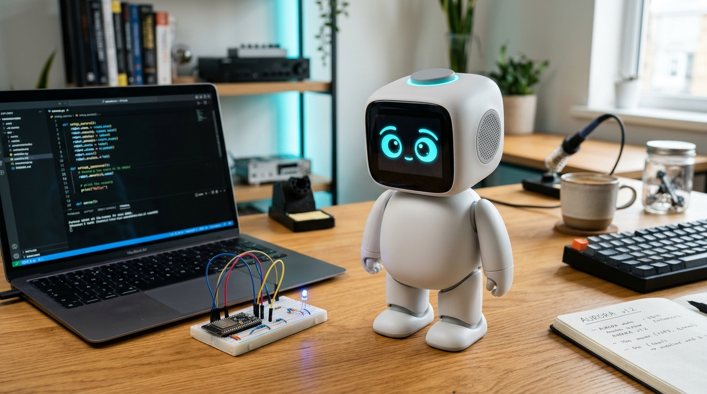
</p>

A compact tabletop voice robot (~20–30 cm, inspired by OttoRobot + XiaoZhi AI) powered by an **`ESP32-S3-WROOM-1-N16R8`** (16 MB Flash, 8 MB Octal PSRAM) and a thin, provider-agnostic Python FastAPI **Voice Gateway** (`STT → LLM → TTS`).

---

## 🧭 1. How the System Works (Two Built-In Modes: Direct On-Chip vs. Gateway)

Your `ESP32-S3-WROOM-1-N16R8` has **8 MB of Octal PSRAM**, which allows `robot_main` to support **both** operating modes out of the box (switchable live via `POST http://<robot-ip>/config` with zero re-flashing):

### Mode A — Direct On-Chip Cloud Mode (`mode = "direct"`, Default — Zero Extra Hop!)
```
┌───────────────────────────────────────────────────┐       Verified TLS (GTS Root R4 / ISRG)       ┌──────────────────────────────────────────┐
│        ESP32-S3 Tabletop Robot (8 MB PSRAM)       │ ────────────────────────────────────────────► │  Google Gemini API & Chit (chitt.online) │
│                                                   │  1. STT: 16kHz WAV base64 -> Gemini Flash     │                                          │
│ • Core 0: 30 FPS ST7789 Eye Animation             │  2. LLM: Gemini Flash OR Chit POST /chat      │ • Zero middleman server needed           │
│ • Core 1: Hands-Free VAD + PTT + Direct TLS       │  3. TTS: Gemini 24kHz base64 decoded in PSRAM │ • Live config via POST /config (NVS)     │
│ • Built-in HTTP Config API: GET/POST /config      │ ◄──────────────────────────────────────────── │                                          │
└───────────────────────────────────────────────────┘                                               └──────────────────────────────────────────┘
```

### Mode B — Voice Gateway Mode (`mode = "gateway"`, Sentence-by-Sentence Streaming)
```
┌───────────────────────────────────────────┐         HTTP / Verified HTTPS         ┌──────────────────────────────────────────────┐
│          ESP32-S3 Tabletop Robot          │ ────────────────────────────────────► │         Python FastAPI Voice Gateway         │
│                                           │   POST /talk (16 kHz s16le mono PCM)  │               (gateway/app.py)               │
│ • Core 0: 30 FPS ST7789 Eye Animation     │   Headers:                            │                                              │
│ • Core 1: Audio I2S + VAD/PTT + Network   │     Authorization: Bearer <TOKEN>     │  1. STT Adapter (Gemini / OpenAI / Mock)     │
│ • INMP441 Mic (16 kHz RX + DC blocker)    │     X-Session-Id: esp32s3-<MAC>       │  2. LLM Adapter (Gemini / Chit / OpenAI)     │
│ • MAX98357A Amp (24 kHz Stereo [L, L] TX) │ ◄──────────────────────────────────── │  3. TTS Adapter (Gemini 24kHz PCM / OpenAI)  │
│ • Zero Cloud API Keys on the Chip         │   200 OK Chunked Stream (24 kHz PCM)  │  • Per-device session memory (X-Session-Id)  │
└───────────────────────────────────────────┘   X-Sample-Rate: 24000, X-Action: WAVE└──────────────────────────────────────────────┘
```

* **Outside-Repo Secrets Isolation**: All sensitive credentials (Wi-Fi password, Bearer token, `GEMINI_API_KEY`, `CHIT_API_KEY`) live **outside** the Git repository in `~/.robo_secrets/` (`C:\Users\<Username>\.robo_secrets\`) or in ESP32 NVS Flash via `POST /config`.

---

## 🛒 2. Hardware Purchase & Compatibility Guide (Exact India Buying Links & Anti-Trap Guide)

> [!NOTE]
> ### 🧭 Hardware Prototyping & Component Reference Guide
> The components listed below correspond to the pin assignments and interface configurations implemented across `include/pins.h`, `src/gate1` through `gate7`, and `src/robot_main/`.
>
> ⚠️ **Marketplace & Specification Notice**:
> Third-party marketplace listings, prices, seller return policies, and component revisions vary over time. Before purchasing, check the seller's return eligibility and terms on the product page, and verify that physical module markings match the required pinout and electrical ratings.

### Master Hardware Reference & Component Shopping Table

| Item | Required Specification in Code | Reference Amazon.in Product *(Check page details before buying)* | Est. Cost (₹) | Code Mapping & Electrical Notes |
| :--- | :--- | :--- | :---: | :--- |
| **1. ESP32-S3 Dev Board** | **`ESP32-S3-WROOM-1-N16R8`** (16MB Flash, **8MB Octal PSRAM**, Dual Type-C) | • [VIREXON ESP32-S3 N16R8 Dev Board (Dual Type-C, 16MB Flash, 8MB PSRAM)](https://www.amazon.in/dp/B0H94PHFSW)<br>• *Alternate:* [AYWHP ESP32-S3-DevKitC WROOM-1-N16R8](https://www.amazon.in/dp/B0DG8L1YW9) | ₹945 – ₹999 | 🔍 **Matches `platformio.ini` line 19–20 & `direct_mode.h`**:<br>• Flash: 16 MB (`default_16MB.csv`)<br>• PSRAM: 8 MB Octal (`qio_opi`). Direct Mode allocates at runtime in PSRAM **3.47 MiB** (3,634,173 B) of audio buffers, leaving approximately 4.53 MiB of nominal PSRAM capacity before other allocations and overhead; Gateway Mode allocates **276.6 KiB** in PSRAM.<br>• Ports: Dual Type-C (`USB` native CDC on GPIO 19/20 + `UART`). Always plug into the port marked **`USB`**.<br>❌ **DO NOT BUY**: `N4` (0 PSRAM) or non-PSRAM clones. |
| **2. I²S Digital Microphone** | **INMP441** Omnidirectional MEMS mic (6-pin digital I²S breakout) | • [INMP441 MEMS Omnidirectional I2S Mic Module](https://www.amazon.in/dp/B0HKSFP54P)<br>• *Super-Value Combo:* [MAX98357A Amp + INMP441 Mic Audio Combo](https://www.amazon.in/dp/B0H3M78HQV)<br>• 🟢 **Pre-Soldered Alternative:** Look for listings stating *"Pre-soldered headers"* or showing welded pins in review photos. | ₹199 (or ₹407 for combo) | 🔍 **Matches `include/pins.h` lines 12–14 & `gate3_mic`**:<br>• `PIN_MIC_BCLK` = GPIO 4 (SCK)<br>• `PIN_MIC_WS` = GPIO 5 (WS)<br>• `PIN_MIC_SD` = GPIO 6 (SD)<br>• Tie `L/R` to `GND` for Left channel (matches `I2S_CHANNEL_FMT_ONLY_LEFT`).<br>• Power from **3.3V ONLY** (5V destroys the MEMS chip). Add `0.1 µF` ceramic capacitor across `VDD–GND`. |
| **3. I²S Class-D Audio Amp** | **MAX98357A** Mono I²S DAC + 3W Class-D amplifier breakout (7-pin) | • [MAX98357 I2S 3W Class D Audio Amplifier Module](https://www.amazon.in/dp/B0H36Z79CD)<br>• *Alternate:* [MAX98357 I2S 3W Audio Module](https://www.amazon.in/dp/B0D5VG962Q)<br>• 🟢 **Pre-Soldered Alternative:** Look for listings stating *"Pre-soldered headers"* or use the ₹40 local shop solder fallback. | ₹249 | 🔍 **Matches `include/pins.h` lines 24–26 & `gate4_speaker`**:<br>• `PIN_AMP_BCLK` = GPIO 15<br>• `PIN_AMP_LRC` = GPIO 16<br>• `PIN_AMP_DIN` = GPIO 7<br>• `GAIN`: Leave **unconnected / floating** for standard **9 dB** default (or 100kΩ to VIN for 3 dB, direct to VIN for 6 dB).<br>• `SD` (SD_MODE): Check your exact breakout board's pull-up arrangement before wiring. On breakouts with an onboard pull-up resistor to VIN, leaving `SD` unconnected keeps the amp enabled. If your module lacks an onboard pull-up or outputs no sound when floating, tie `SD` to `VIN` through a 100 kΩ resistor.<br>• Connect `VIN` to **`5V` (`VBUS`)**. Add `1000 µF 25V/16V` capacitor across `5V–GND` rail to help cushion supply dips during audio peaks. |
| **4. Miniature Speaker** | **8Ω 2W** (Preferred) or **8Ω 3W** miniature speaker (28–40 mm diameter) | • [Mini 2-Inch 8 Ohm 3W Speaker Driver](https://www.amazon.in/dp/B0HNGZX1KV)<br>• *Budget Alternate:* [Electronic Spices 40mm 8 Ohm Speaker](https://www.amazon.in/dp/B07MTK843Z) | ₹106 – ₹290 | 🔍 **Power & Impedance Notes (`gate4_speaker` & `robot_main`)**:<br>• An 8 Ω speaker is recommended as a sensible conservative load for USB-powered prototypes compared to 4 Ω. Current draw depends on volume setting and audio dynamics, but 8 Ω presents a gentler load on the supply rail.<br>• Directly wire speaker terminals to the `+` and `-` outputs of the MAX98357A. |
| **5. IPS SPI Color Display** | **ST7789** 1.3" or 1.54" **240×240 IPS TFT** (SPI Interface, 7-pin or 8-pin) | • **Recommended (7-Pin):** [1.3" 240×240 RGB TFT IPS Module (7-Pin ST7789)](https://www.amazon.in/dp/B0CTQXNQWY)<br>• *Alternate (8-Pin):* [1.54" SPI TFT LCD 240x240 RGB 8-Pin ST7789](https://www.amazon.in/dp/B0DFWL5Q9F) | ₹580 – ₹799 | 🔍 **Pinout & Configuration (`include/pins.h` lines 30–43 & `gate2_display`)**:<br>• `PIN_TFT_MOSI` = GPIO 11 (SDA), `PIN_TFT_SCLK` = GPIO 12 (SCL)<br>• `PIN_TFT_DC` = GPIO 9, `PIN_TFT_RST` = GPIO 14, `PIN_TFT_BL` = GPIO 13<br>• **7-Pin display (no CS pin)**: Matches current code default (`#define TFT_HAS_CS_PIN 0`, SPI Mode 3, `pin_cs = -1`).<br>• **8-Pin display (with CS)**: Requires changing line 30 in `include/pins.h` to `#define TFT_HAS_CS_PIN 1` (SPI Mode 0, `pin_cs = 10`) and wiring `CS` to `GPIO 10`. Verify module SPI mode compatibility.<br>• Power from **3.3V ONLY**.<br>• *Header note:* 7-pin and 8-pin ST7789 modules arrive with headers pre-soldered at the factory. |
| **6. Prototyping Essentials** | **830-Point Breadboard** + Dupont Wires + Tactile Button + 1000µF & 0.1µF Capacitors | • **Breadboard & Wires:** [ApTechDeals 840-Point Breadboard with 30-pc Jumper Wire Set](https://www.amazon.in/dp/B07PQS67BN)<br>• **Passives & Filtering Pack:** [Robodo 1000uF 25V Electrolytic Capacitor (Pack of 10)](https://www.amazon.in/dp/B09VL23ZP1) + 6x6mm Tactile Buttons / 0.1µF Ceramic Pack | ₹196 + ₹149 | 🔍 **Matches `include/pins.h` line 50 & Audio Filtering**:<br>• **1× 1000 µF 25V/16V electrolytic capacitor** across breadboard `5V–GND` rail (recommended to help reduce supply dips during audio peaks; does not guarantee immunity against high cable resistance or strict host port limits).<br>• **1× 0.1 µF ceramic capacitor** across `INMP441` `VDD–GND` (decouples 2.4 GHz Wi-Fi RF noise).<br>• **Tactile pushbutton** connects `PIN_PTT_BTN` (GPIO 1) to `GND` (uses internal `INPUT_PULLUP`). |
| **7. Basic Soldering Kit** | **25W–60W Soldering Iron** + 60/40 rosin-core solder wire + flux paste | • [Aptechdeals Soldering Kit Beginner 6-in-1](https://www.amazon.in/dp/B07D1PQ7TM)<br>• *Alternate:* [Themisto Beginners 8-in-1 Soldering Iron Kit](https://www.amazon.in/dp/B07PM6134P) | ₹220 – ₹242 | 🔍 **Physical Reliability Guardrail & Solderless Option**:<br>• `INMP441` and `MAX98357A` ship with loose header pins in standard listings. Solder the headers before inserting into the breadboard to eliminate I²S clock jitter and intermittent reboot loops.<br>• 🟢 **OPTIONAL / SKIPPABLE**: If you buy pre-soldered modules or have a local mobile phone repair shop solder the 13 pins for ₹40 in 2 minutes, this soldering kit is **not required and can be omitted or returned**! |

---

### 💰 Total Kit Cost Estimate (DIY Soldered Option)

| Item | Selected Product | Cost (₹) | Order Status |
| :--- | :--- | :---: | :---: |
| **ESP32-S3 N16R8 Board** | [VIREXON ESP32-S3 N16R8 (16MB Flash, 8MB PSRAM)](https://www.amazon.in/dp/B0H94PHFSW) | ₹945 | ✅ **Ordered** *(Arriving Sunday)* |
| **Audio Modules Combo** | [MAX98357A I²S Amp + INMP441 Mic Audio Combo](https://www.amazon.in/dp/B0H3M78HQV) *(or separately ₹199 + ₹249)* | ₹407 | 🛒 In Shopping List |
| **8Ω 3W Speaker** | [Mini 2-Inch 8 Ohm 3W Speaker Driver](https://www.amazon.in/dp/B0HNGZX1KV) | ₹290 | 🛒 In Shopping List |
| **ST7789 IPS Display** | [1.3-inch 240×240 RGB TFT IPS LCD Module (7-Pin ST7789)](https://www.amazon.in/dp/B0CTQXNQWY) | ₹580 | 🛒 In Shopping List |
| **830-Pt Breadboard Kit** | [ApTechDeals 840-Point Breadboard with 30-pc Jumper Wires](https://www.amazon.in/dp/B07PQS67BN) | ₹196 | ✅ **Ordered** |
| **Passives Filtering Pack**| [Robodo 1000uF 25V Electrolytic Capacitors (Pack of 10)](https://www.amazon.in/dp/B09VL23ZP1) + Buttons/Caps | ₹149 | 🛒 In Shopping List |
| **Soldering Iron Kit** | [Aptechdeals Soldering Kit Beginner 6-in-1](https://www.amazon.in/dp/B07D1PQ7TM) | ₹242 | ✅ **Delivered Today** |
| **TOTAL** | **Estimated Hardware Component Cost (DIY Solder Path)** | **~₹2,809 INR** | **3 of 7 Ordered** |

> ℹ️ *Diagnostic Tool: Digital Multimeter is also ✅ **Ordered** (Arriving Tomorrow).*

---

### 💰 Total Kit Cost Estimate (Pre-Soldered / Zero-Iron Option)

| Item | Selected Product / Solderless Alternative | Cost (₹) | Order Status |
| :--- | :--- | :---: | :---: |
| **ESP32-S3 N16R8 Board** | [VIREXON ESP32-S3 N16R8](https://www.amazon.in/dp/B0H94PHFSW) *(All 44 pins factory pre-soldered)* | ₹945 | ✅ **Ordered** *(Arriving Sunday)* |
| **Audio Modules Combo** | [MAX98357A + INMP441 Combo](https://www.amazon.in/dp/B0H3M78HQV) *(Pre-soldered or ₹40 local technician fee)* | ₹407 – ₹447 | 🛒 In Shopping List |
| **8Ω 3W Speaker** | [Mini 2-Inch 8 Ohm 3W Speaker Driver](https://www.amazon.in/dp/B0HNGZX1KV) *(Pre-wired leads)* | ₹290 | 🛒 In Shopping List |
| **ST7789 IPS Display** | [1.3-inch 240×240 RGB TFT IPS (7-Pin ST7789)](https://www.amazon.in/dp/B0CTQXNQWY) *(Factory pre-soldered)* | ₹580 | 🛒 In Shopping List |
| **830-Pt Breadboard Kit** | [ApTechDeals 840-Point Breadboard + Jumper Wires](https://www.amazon.in/dp/B07PQS67BN) *(100% plug-and-play)* | ₹196 | ✅ **Ordered** |
| **Passives Filtering Pack**| [Robodo 1000uF 25V Capacitors](https://www.amazon.in/dp/B09VL23ZP1) + Buttons/Caps *(Push-in)* | ₹149 | 🛒 In Shopping List |
| **Soldering Iron Kit** | **NONE NEEDED** *(Can return delivered kit for ₹242 refund)* | **₹0** | 🔄 Returnable (₹0) |
| **TOTAL** | **Estimated Hardware Component Cost (100% Solderless Path)** | **~₹2,607 INR** | **2 of 6 Ordered** |

---

### 📸 Hardware-to-Code Visual Linkage Map

This visual reference maps each physical component arriving in your delivery directly to its software driver configuration in [`include/pins.h`](include/pins.h), its isolated verification gate test in [`src/`](src/), and its role in the final production system:

| Physical Component & Visual Identification | Power Rail & Spec | Hardware Pins (`include/pins.h`) | Verification Gate Firmware | Production Robot Role (`robot_main`) |
| :---: | :--- | :--- | :--- | :--- |
| 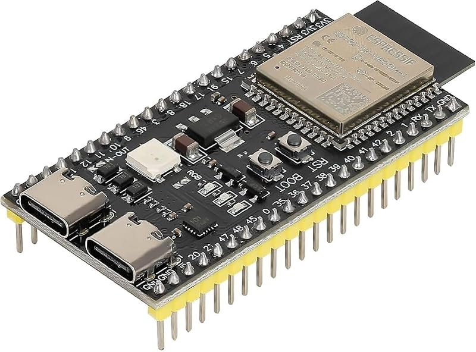<br>**ESP32-S3 N16R8**<br>*(Metal shield reads N16R8, Dual Type-C)* | **5V via USB-C**<br>• 16MB Flash<br>• 8MB Octal PSRAM<br>• Dual Xtensa LX7 | • Native USB CDC: `GPIO 19/20`<br>• Octal PSRAM Bus: `GPIO 26–37` (internal)<br>• Boot strap: `GPIO 0` | [`src/gate1_board/main.cpp`](src/gate1_board/main.cpp)<br>`pio run -e gate1_board -t upload -t monitor` | Core 0 runs 30 FPS display engine; Core 1 runs VAD, PTT, audio capture & direct TLS cloud streaming. |
| 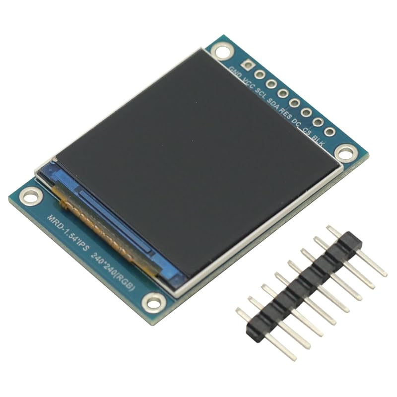<br>**ST7789 IPS Display**<br>*(1.3" 240×240 IPS, 7-pin pre-soldered)* | **3.3V ONLY**<br>• 40 MHz SPI<br>• IPS full viewing angle | • `MOSI` (SDA) -> `GPIO 11`<br>• `SCLK` (SCL) -> `GPIO 12`<br>• `DC` -> `GPIO 9`<br>• `RST` -> `GPIO 14`<br>• `BL` -> `GPIO 13`<br>• `CS` -> `-1` (`TFT_HAS_CS_PIN 0`) | [`src/gate2_display/main.cpp`](src/gate2_display/main.cpp)<br>`pio run -e gate2_display -t upload -t monitor` | Renders dynamic cyan animated eyes and expressions (`BOOT`, `IDLE`, `LISTENING`, `THINKING`, `SPEAKING`, `ERROR`) from PSRAM canvas. |
| 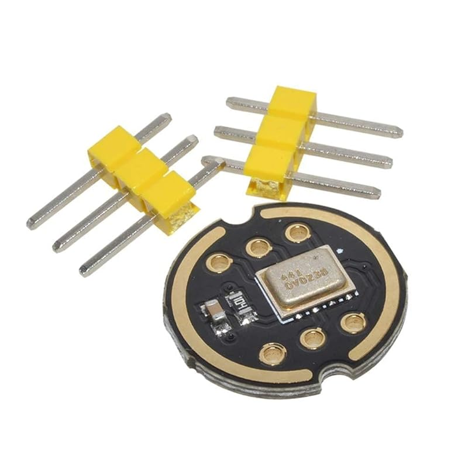<br>**INMP441 I²S Mic**<br>*(Tiny gold acoustic hole on bottom face)* | **3.3V ONLY**<br>*(5V will destroy it!)*<br>• 16 kHz 32-bit I²S<br>• Place 0.1µF cap across VDD-GND | • `SCK` (BCLK) -> `GPIO 4`<br>• `WS` (LRCLK) -> `GPIO 5`<br>• `SD` (DOUT) -> `GPIO 6`<br>• `L/R` -> `GND` (Left channel) | [`src/gate3_mic/main.cpp`](src/gate3_mic/main.cpp)<br>`pio run -e gate3_mic -t upload -t monitor` | Always-on microphone stream with fixed-point DC-bias filter, RMS energy speech detector (Hands-free VAD), and audio capture buffer. |
| 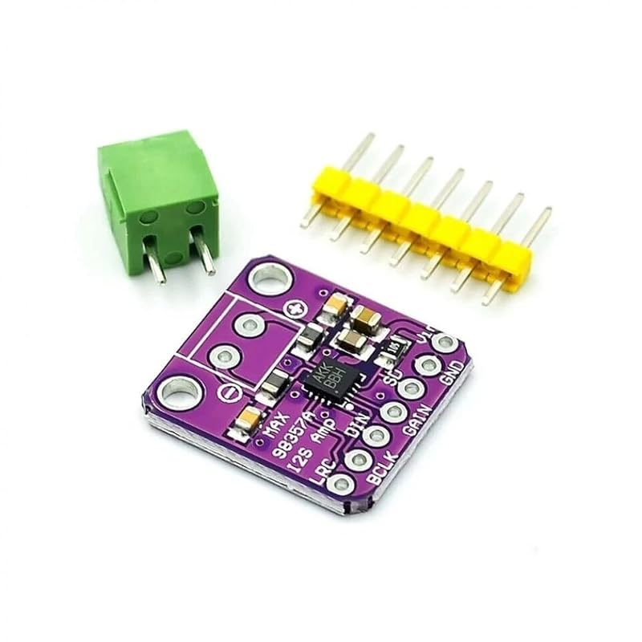<br>**MAX98357A I²S Amp**<br>*(Purple board with chip & terminal blocks)* | **5V (VBUS)**<br>• 3W Class-D mono DAC<br>• Place 1000µF cap across 5V-GND rail | • `BCLK` -> `GPIO 15`<br>• `LRC` -> `GPIO 16`<br>• `DIN` -> `GPIO 7`<br>• `GAIN` -> Floating (9 dB default)<br>• `SD` -> Floating / Pull-up | [`src/gate4_speaker/main.cpp`](src/gate4_speaker/main.cpp)<br>`pio run -e gate4_speaker -t upload -t monitor` | High-fidelity 24 kHz audio playback engine with software stereo-cloned `[L, L]` frames and click-free attack/release ramp curves. |
| 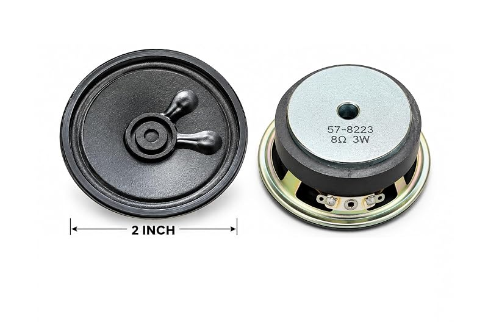<br>**8Ω 3W Speaker**<br>*(2-inch driver with pre-wired red/black leads)* | **Driven by Amp**<br>• 8 Ohm impedance<br>• Low peak draw avoids USB brownout | • `+` (Red lead) -> Amp `+`<br>• `-` (Black lead) -> Amp `-`<br>*(Polarity is reversible for mono voice)* | [`src/gate4_speaker/main.cpp`](src/gate4_speaker/main.cpp)<br>`pio run -e gate4_speaker -t upload -t monitor` | Voice output for AI speech synthesis playback and local audio loopback playback. |
| 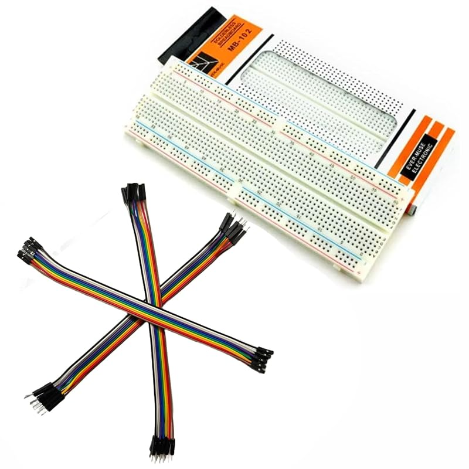<br>**Breadboard & PTT**<br>*(830 points + 6x6mm button + 1000µF cap)* | **Passive / Power Rails**<br>• Split power distribution<br>• Active-LOW pushbutton | • Pushbutton Pin A -> `GPIO 1`<br>• Pushbutton Pin B -> `GND`<br>• 1000µF Cap: `+` to `5V`, `-` stripe to `GND` | [`src/gate5_loopback/main.cpp`](src/gate5_loopback/main.cpp)<br>`pio run -e gate5_loopback -t upload -t monitor` | `GPIO 1` Push-to-Talk hardware override (interrupt-driven with 30ms debounce); 1000µF capacitor prevents Wi-Fi RF brownout resets. |

---

### 📋 4-Step Pre-Flight Checklist (When Your Packages Arrive)

Before plugging anything into USB or power, verify these 4 items:
1. **Verify the ESP32-S3 Metal Can**: Look closely at the laser engraving on the metal shield. It **must** read `ESP32-S3-WROOM-1-N16R8` (preferred) or `N8R8` (8 MB Octal PSRAM).
   * ⚠️ **Flash Setting for `N8R8`**: The project defaults to `16MB` flash (`default_16MB.csv`). If your board is an `N8R8` (8 MB Flash), you **must** change `platformio.ini` lines 19–20 to `board_upload.flash_size = 8MB` and `board_build.partitions = default_8MB.csv` before uploading, or the chip will continuously bootloop!
   * If the shield reads `N4` (0 PSRAM) or `ESP32-WROOM-32` (old ESP32), initiate an immediate return.
2. **Solder the Header Pins**: Solder the 6-pin header on the `INMP441` and the 7-pin header on the `MAX98357A`. Solder joints should look like clean, shiny little cones.
3. **Power Rails Grounding**: Double check that `INMP441` and `ST7789` are plugged into the **3.3V** rail, and `MAX98357A` is plugged into the **5V (`VBUS`)** rail with the `1000 µF` capacitor installed across `5V` and `GND`.
4. **USB Port Selection**: When connecting to your PC/laptop, plug into the USB-C port labeled **`USB`** (native USB CDC on GPIO 19/20). The port labeled `UART` will not display the runtime serial logs.

---

### 🔌 Practical Assembly & Testing Walkthrough: What to Do & How to Do It

If this is your first time setting up breadboard hardware, do not worry at all. Think of this hardware setup like setting up a clean microservice architecture: each physical module is an independent service with its own power requirements and data bus, and we test them one by one.

#### ⚠️ Three Golden Rules Before You Start Wiring
1. **Never Wire While Plugged In**: Always unplug the USB-C cable from your laptop before moving any jumper wires or plugging in any component.
2. **Respect the Power Rails (3.3V vs 5V)**:
   * **3.3V** is for delicate modules (`INMP441` mic and `ST7789` display). If you accidentally give them 5V, they will burn out permanently.
   * **5V (`VBUS`)** is only for the `MAX98357A` speaker amplifier.
3. **Use the Correct USB Port**: Your ESP32-S3 board has two Type-C ports. Always connect your cable to the port clearly labeled **`USB`** (native CDC on GPIO 19/20). The port labeled `UART` will not show live runtime logs.

---

#### Step 1: Understand the White Board (Breadboard), Wire Connectors & Run Gate 1
<p align="center">
  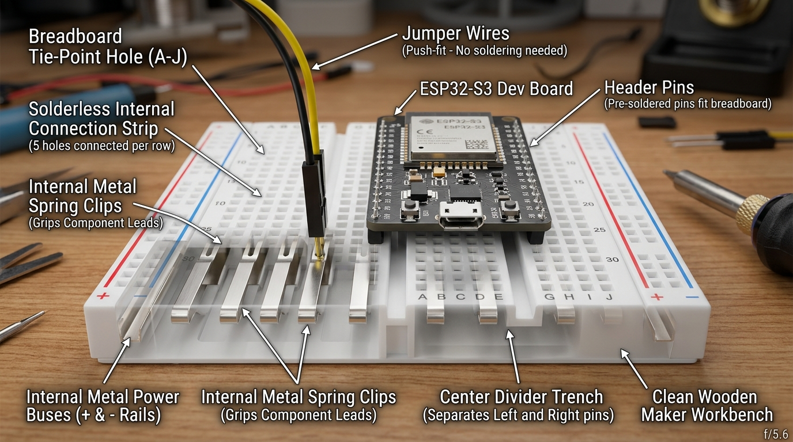
</p>

##### 💡 First: What is that White Plastic Board? (The Solderless Breadboard)
If you are holding this white board for the first time, think of it as a reusable, plug-and-play socket board. You do **not** need to solder any wires! Here is how it works inside:
1. **Hidden Metal Spring Clips**: Underneath every row of 5 holes (labeled `a, b, c, d, e`), there is a hidden metal spring clip strip.
   * *The Golden Rule*: All 5 holes in the same numbered horizontal row are connected together inside!
   * *Example*: If you plug an ESP32 pin into hole `15c`, and push a jumper wire into hole `15b` (or `15a`, `15d`, `15e`), they are now electrically connected together by the hidden clip underneath!
2. **The Center Divider Trench**: The ditch/groove running down the exact center divides the left half from the right half. Holes on the left side of the trench do **not** touch holes on the right side.
   * *Crucial Rule*: You **must** mount your ESP32-S3 board straddling this center ditch, so its left pins and right pins stay completely independent!
3. **Power Rails (The Side Columns)**: The long columns on the outer edges marked with red (`+`) and blue/black (`-`) stripes are connected vertically all the way down. This is where you bring `3.3V`, `5V`, and `GND` so any component can easily plug in for power.

---

##### 🔌 Second: How Do Wires & Pins Connect? (Soldering vs. Plug-and-Play)
<p align="center">
  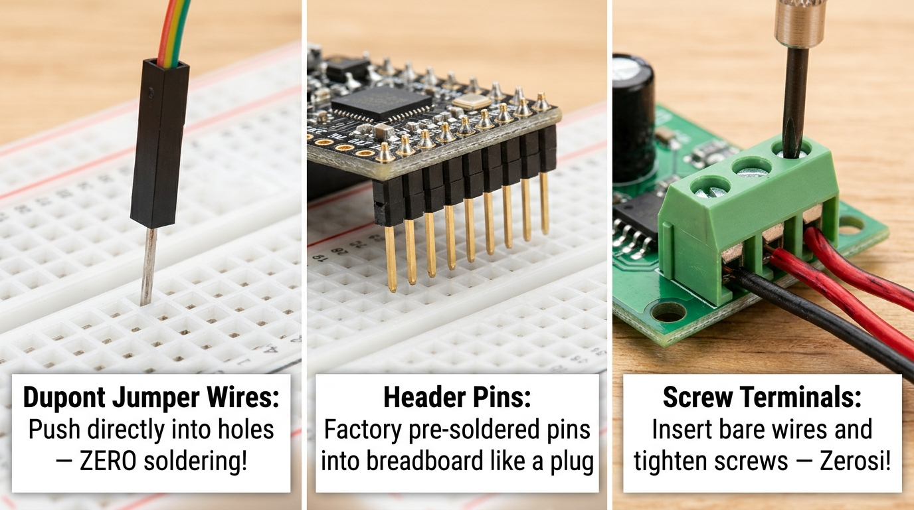
</p>

1. **The Colorful Dupont Jumper Wires**:
   * These wires have a stiff, pointed metal pin on both ends (Male-to-Male).
   * **Zero Soldering for Wires**: You never solder wires! You just push the pointed pin straight into a breadboard hole with your fingers. The hidden spring clip grabs it tightly. To remove or change it, just pull it out.
2. **The Header Pins (Metal Legs on Modules)**:
   * **ESP32-S3 & ST7789 Display**: Arrive with their metal pins already factory-welded (pre-soldered). You simply push the board straight down into the breadboard holes like plugging a charger into a wall socket.
   * **INMP441 Mic & MAX98357A Amp**: Usually ship with a loose strip of metal pins in the plastic pouch.
     * *Easiest Zero-Iron Option*: Take the two small modules and the loose pin strips to any local mobile phone or electronics repair shop. The technician will solder the pins for ₹30–₹40 in 2 minutes.
     * *DIY Iron Option*: If soldering yourself, place the long legs of the pins into the breadboard, sit the module on top so the short pins poke through the gold ring pads, touch the iron tip to the pad for 2 seconds, and feed a tiny touch of solder wire until a clean, shiny cone forms.
3. **The Speaker Wires**:
   * The 8Ω speaker has two bare wires (Red `+` and Black `-`). On the MAX98357A amplifier board, there is a small terminal block with two screws.
   * Simply loosen the screws with a mini screwdriver, slide the bare wire tips into the holes, and tighten the screws. Zero soldering needed!

---

##### 🚀 Now Place the Board & Run Gate 1
<p align="center">
  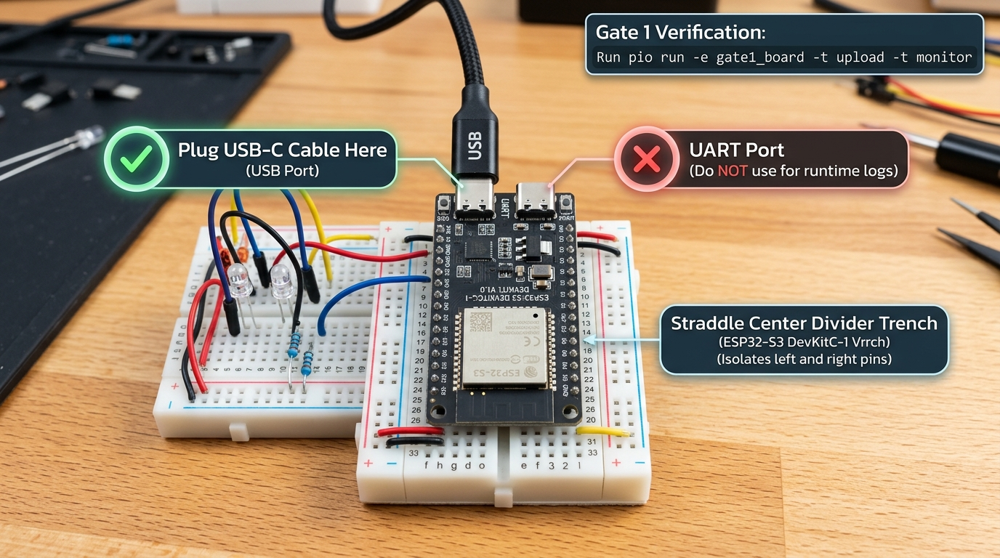
</p>

* **What to do?**
  1. Place the ESP32-S3 board so it straddles the center divider groove on the breadboard. The left row of pins goes into the left holes, and the right row goes into the right holes. Press gently and evenly until it sits firmly.
  2. Do not connect any other wires yet!
  3. Connect your USB-C cable from your laptop into the port labeled **`USB`** (not UART!).
* **How to test?** Open your terminal in `c:\Robo` and run:
  ```powershell
  python -m platformio run -e gate1_board -t upload -t monitor
  ```
* **Expected Output**: The terminal will print the chip model, confirm 16 MB Flash, and run a 1 MB read/write test across the 8 MB Octal PSRAM. You should see `[GATE 1 PASSED: PSRAM OK]`. Unplug the USB cable once verified.

---

#### Step 2: Wire the ST7789 Color Display & Run Gate 2
<div align="center">
  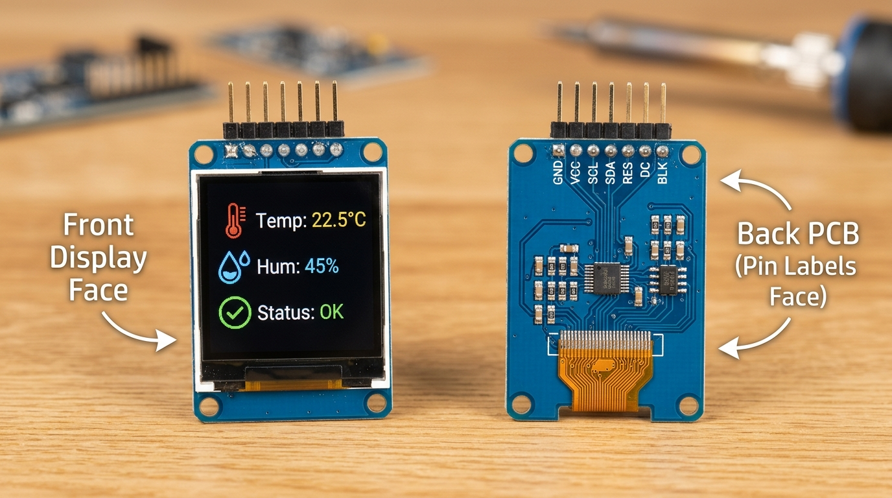
  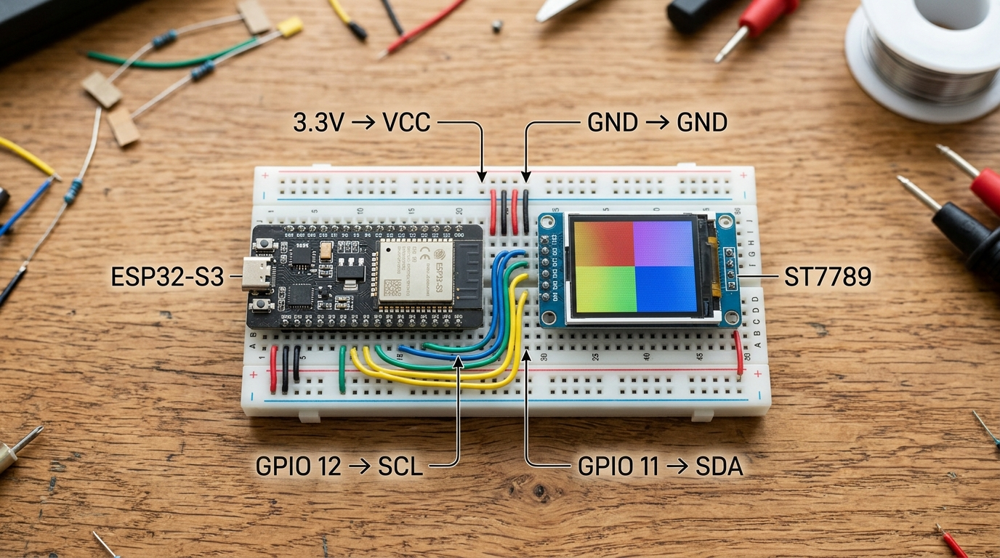
</div>

* **What is this?** This is your robot's face. It is a 1.3-inch high-clarity IPS screen that renders animated eye expressions at 30+ FPS.
* **Finding the Pin Labels**: Turn the screen module over and look at the **Back PCB Face** (as shown in the left photo above). You will see the silk-screen labels printed in white next to the 7 pins: `GND`, `VCC`, `SCL`, `SDA`, `RES`, `DC`, `BLK`.
* **What to do?**
  1. Insert the 7-pin display module into the breadboard, or use jumper wires.
  2. Connect the wires carefully to the ESP32-S3 pins (as shown in the right photo above):
     * `GND` -> ESP32 `GND`
     * `VCC` -> ESP32 **`3.3V`** *(Strictly 3.3V! Do not connect to 5V!)*
     * `SCL` -> `GPIO 12` (SPI Clock)
     * `SDA` -> `GPIO 11` (SPI Data / MOSI)
     * `RES` (Reset) -> `GPIO 14`
     * `DC` (Data/Command) -> `GPIO 9`
     * `BLK` (Backlight) -> `GPIO 13`
  3. Plug the USB cable back into the laptop.
* **How to test?** Run:
  ```powershell
  python -m platformio run -e gate2_display -t upload -t monitor
  ```
* **Expected Output**: The screen will light up immediately with vivid cyan robot eyes that blink smoothly at ~33 FPS. Unplug the USB cable once verified.

---

#### Step 3: Wire the INMP441 Microphone & Run Gate 3
<p align="center">
  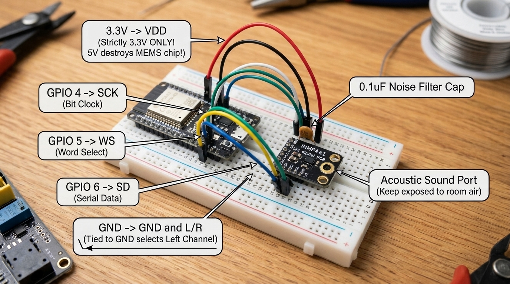
</p>

* **What is this?** This is your robot's ear. It is an omnidirectional digital microphone that streams 16,000 audio samples every second directly into the chip.
* **Visual Identification**: Look at the underside of the small black board—you will see a tiny golden circular hole (shown with the arrow in the photo above). That is the acoustic sound port where sound enters. Keep this face exposed to the air.
* **What to do?**
  1. Insert the microphone into the breadboard and connect the 6 pins using jumper wires:
     * `VDD` -> ESP32 **`3.3V`** *(Strictly 3.3V! 5V will permanently burn this chip!)*
     * `GND` -> ESP32 `GND`
     * `L/R` -> ESP32 `GND` *(Connecting L/R to GND selects Left audio channel)*
     * `SCK` -> `GPIO 4`
     * `WS`  -> `GPIO 5`
     * `SD`  -> `GPIO 6`
  2. *(Noise Filter)* Push a small `0.1 µF` ceramic capacitor across the breadboard rows for `VDD` and `GND` near the mic to filter out Wi-Fi hum.
  3. Plug the USB cable back in.
* **How to test?** Run:
  ```powershell
  python -m platformio run -e gate3_mic -t upload -t monitor
  ```
* **Expected Output**: The terminal will print live audio RMS values. When you speak or snap your fingers near the mic, the RMS level numbers will jump visibly. Unplug the USB cable once verified.

---

#### Step 4: Wire the MAX98357A Amplifier, 8Ω Speaker & Run Gate 4
<p align="center">
  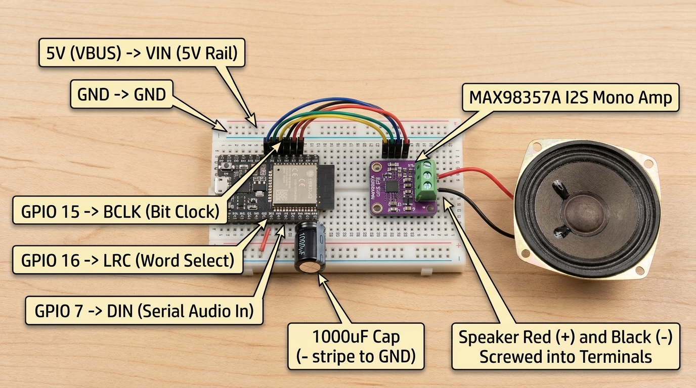
</p>

* **What is this?** This is your robot's mouth. The purple board is a 3-Watt Class-D digital amplifier, and the circular metal unit is the 8 Ohm speaker.
* **What to do?**
  1. Connect the two speaker wires to the green screw terminal blocks on the amplifier (Red to `+`, Black to `-`). Tighten the small screws gently with a mini screwdriver.
  2. Connect the amplifier's pins to the ESP32-S3:
     * `VIN` -> ESP32 **`5V` (`VBUS`)**
     * `GND` -> ESP32 `GND`
     * `BCLK` -> `GPIO 15`
     * `LRC`  -> `GPIO 16`
     * `DIN`  -> `GPIO 7`
     * `GAIN` -> Leave disconnected (floating for 9 dB default volume)
     * `SD`   -> Leave disconnected (or connect to `VIN` through a 100k resistor if your board needs manual pull-up)
  3. *(Power Cushion)* Insert the large black cylinder capacitor (`1000 µF`) across the `5V` and `GND` rails on the breadboard.
     * **Polarity Check**: Look for the grey vertical stripe with minus signs (`-`) on the capacitor body. That leg goes to `GND`. The other leg goes to `5V`.
  4. Plug the USB cable back in.
* **How to test?** Run:
  ```powershell
  python -m platformio run -e gate4_speaker -t upload -t monitor
  ```
* **Expected Output**: The speaker will play a clear 440 Hz test tone followed by a pleasant two-note chime at 24 kHz. No crackle or reboots. Unplug the USB cable once verified.

---

#### Step 5: Wire the Push-to-Talk Button & Test Voice Loopback (Gate 5)
<p align="center">
  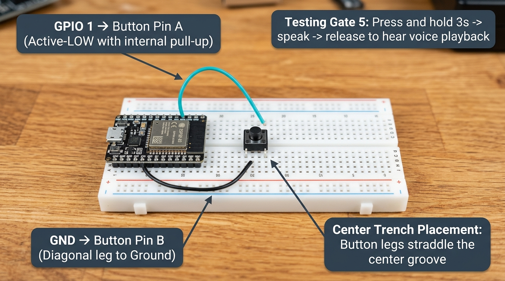
</p>

* **What is this?** This is your offline voice verification gate and manual push-to-talk button.
* **What to do?**
  1. Insert the 4-pin tactile pushbutton into the breadboard across the center divider trench.
  2. Connect one side (Pin A) to `GPIO 1` on the ESP32-S3.
  3. Connect the diagonal side (Pin B) to `GND`.
  4. Plug the USB cable back in.
* **How to test?** Run:
  ```powershell
  python -m platformio run -e gate5_loopback -t upload -t monitor
  ```
* **Expected Output**:
  1. Press and hold the pushbutton on the breadboard and speak clearly: *"Hello robot testing 1 2 3."*
  2. Release the button.
  3. The speaker will immediately play back your exact recorded voice in crystal-clear audio from PSRAM! If you hear your voice, all audio input and output hardware is 100% verified.

---

#### Step 6: Flash Production Robot Firmware (`robot_main`)
Once all individual gates pass, you are ready to flash the complete production software:
```powershell
python -m platformio run -e robot_main -t upload -t monitor
```
Your robot will boot up, display animated eyes on the screen, connect to Wi-Fi, listen hands-free with VAD (Voice Activity Detection), and talk with you using Cloud AI voice!

---

## 📂 3. Purpose of Every File in This Repository

```text
RoboAssistant/
├── README.md                        # Complete How-To Guide & file-by-file reference (this file)
├── ROADMAP.md                       # Master BOM (parts list), pin map, and 12-Gate engineering checklist
├── platformio.ini                   # Pinned PlatformIO build config (espressif32 @ 6.9.0) with 8 environments
├── .gitignore                       # Blocks build artifacts, audio scratch files, and any secret files from Git
│
├── scripts/
│   └── load_secrets_inc.py          # Pre-build script that auto-discovers ~/.robo_secrets across any OS/user
│
├── include/
│   ├── pins.h                       # Single source of truth for all ESP32-S3 GPIOs & hardware toggles
│   ├── certs.h                      # Multi-root TLS CA bundle (ISRG Root X2, Root YE, ISRG Root X1, GlobalSign R4)
│   └── secrets.h.example            # Template showing what goes inside ~/.robo_secrets/robot_secrets.h
│
├── src/
│   ├── gate1_board/main.cpp         # Gate 1: Verifies ESP32-S3 chip, 16 MB Flash, and 8 MB Octal PSRAM R/W
│   ├── gate2_display/main.cpp       # Gate 2: Verifies ST7789 240x240 TFT & 30+ FPS PSRAM blinking eye sprite
│   ├── gate3_mic/main.cpp           # Gate 3: Verifies INMP441 I2S mic (16 kHz), DC-blocker, and Serial Plotter RMS
│   ├── gate4_speaker/main.cpp       # Gate 4: Verifies MAX98357A amp + speaker (24 kHz stereo [L,L], zero brownout)
│   ├── gate5_loopback/main.cpp      # Gate 5: Records 3s from mic into PSRAM on GPIO 1 hold & plays it back locally
│   ├── gate6_health/main.cpp        # Gate 6: Verifies 2.4 GHz Wi-Fi, NTP clock sync, and TLS GET /health
│   ├── gate7_echo/main.cpp          # Gate 7: Streams 16 kHz mic audio to POST /echo & plays back chunked response
│   └── robot_main/
│       ├── main.cpp                 # Gates 9–12 + VAD: Dual-core robot (Hands-Free VAD + PTT + Face + Direct/Gateway)
│       ├── direct_mode.h            # Direct On-Chip pipeline (ESP32 PSRAM -> Gemini STT -> Gemini/Chit LLM -> Gemini TTS)
│       └── robot_config.h           # Live NVS Flash config store + authenticated GET/POST http://<robot-ip>/config API
│
└── gateway/
    ├── app.py                       # FastAPI server exposing /health, /echo, and /talk with per-device sessions
    ├── adapters.py                  # Pluggable async adapters for Gemini, Chit (api.chitt.online), OpenAI, and Mock
    ├── requirements.txt             # Lightweight Python dependencies (fastapi, uvicorn, httpx, python-dotenv)
    ├── .env.example                 # Template showing what goes inside ~/.robo_secrets/gateway.env
    ├── test_gateway.py              # Offline unit & fault-injection test suite (auth, odd-byte, 504/502, mid-stream, Chit)
    ├── test_live_gemini.py          # Live end-to-end test using your real Gemini key (plays voice on laptop speakers)
    ├── Containerfile                # Lightweight Python 3.13 container build file for AWS EC2 deployment
    └── DEPLOY.md                    # Step-by-step instructions to deploy alongside Chit behind Caddy on AWS EC2
```

### Detailed File Reference Table

| File Path | Purpose & When You Touch It |
| :--- | :--- |
| [`README.md`](README.md) | Step-by-step setup, wiring, flashing, and operational guide. |
| [`ROADMAP.md`](ROADMAP.md) | Shopping list (Phase 0 BOM with ₹ prices and soldering notes), forbidden ESP32-S3 pins, and pass/fail criteria for all 12 verification gates. |
| [`platformio.ini`](platformio.ini) | Pins `espressif32 @ 6.9.0` (Arduino-ESP32 v2.0.17 legacy I²S driver) and defines 8 isolated build targets (`gate1_board` through `robot_main`). Edit lines 19–20 only if you buy an `N8R8` (8 MB Flash) board instead of `N16R8` (16 MB Flash). |
| [`scripts/load_secrets_inc.py`](scripts/load_secrets_inc.py) | Automatically adds `~/.robo_secrets` (or `$ROBO_SECRETS_DIR`) to the C++ include path at compile time so no Windows username is ever hardcoded in `platformio.ini`. |
| [`include/pins.h`](include/pins.h) | Defines every GPIO pin (`INMP441`, `MAX98357A`, `ST7789`, `GPIO 1` button, `GPIO 18` servo) plus three 1-line toggles: `TFT_HAS_CS_PIN` (`0` for standard 7-pin CS-less display default, `1` for 8-pin display), `ENABLE_AUTO_VAD_DEFAULT` (`1` for hands-free listening on boot), and `ENABLE_SERVO_ARM` (`0` until external 5V 2A power is attached). |
| [`include/certs.h`](include/certs.h) | Pinned Root CA certificates (`ISRG Root X2`, `ISRG Root YE`, `ISRG Root X1`, `GlobalSign ECC Root CA - R4`) used by `WiFiClientSecure` so HTTPS never uses `setInsecure()`. |
| [`include/secrets.h.example`](include/secrets.h.example) | Safe example template for `~/.robo_secrets/robot_secrets.h`. |
| [`src/gate1_board/main.cpp`](src/gate1_board/main.cpp) | **Hardware Test 1**: Prints chip model, Flash size, and PSRAM size, and runs a 1 MB R/W verification across Octal PSRAM. Run this immediately when your ESP32-S3 arrives. |
| [`src/gate2_display/main.cpp`](src/gate2_display/main.cpp) | **Hardware Test 2**: Initializes the ST7789 240×240 display via LovyanGFX and animates blinking cyan eyes from a PSRAM sprite at ~33 FPS. |
| [`src/gate3_mic/main.cpp`](src/gate3_mic/main.cpp) | **Hardware Test 3**: Reads 16 kHz 32-bit I²S samples from `INMP441` on `I2S_NUM_0`, removes DC offset via a fixed-point IIR filter, and prints live RMS + peak audio levels for the Serial Plotter. |
| [`src/gate4_speaker/main.cpp`](src/gate4_speaker/main.cpp) | **Hardware Test 4**: Plays a 440 Hz tone and two-note chime at 24 kHz stereo `[L, L]` on `MAX98357A` (`I2S_NUM_1`) with click-free attack/release envelopes to verify USB power stability. |
| [`src/gate5_loopback/main.cpp`](src/gate5_loopback/main.cpp) | **Hardware Test 5**: Offline voice recorder—hold `GPIO 1` to record up to 3 seconds into PSRAM (`96 KB`), release to hear your own voice played back through the speaker. |
| [`src/gate6_health/main.cpp`](src/gate6_health/main.cpp) | **Network Test 6**: Connects to 2.4 GHz Wi-Fi, syncs the ESP32 clock via NTP (required for TLS certificate validation), and calls `GET /health` every 10 seconds while monitoring free heap. |
| [`src/gate7_echo/main.cpp`](src/gate7_echo/main.cpp) | **Network Test 7**: Sends recorded 16 kHz PCM audio to `POST /echo` and streams the chunked 16 kHz response back through the 400 ms PSRAM pre-buffer + 1-byte odd-chunk alignment guard. |
| [`src/robot_main/main.cpp`](src/robot_main/main.cpp) | **Production Firmware**: Full dual-core voice robot combining Core 0 30 FPS eye expressions (`BOOT`, `IDLE`, `LISTENING`, `THINKING`, `SPEAKING`, `ERROR`) with Core 1 Hands-Free Always-Listening Energy VAD, `GPIO 1` Push-to-Talk override, and runtime dispatch between Direct On-Chip Mode and Gateway Mode. |
| [`src/robot_main/direct_mode.h`](src/robot_main/direct_mode.h) | **Zero-Hop Direct Cloud Engine**: Uses 8 MB Octal PSRAM buffers (`g_directWavPsram`, `g_directReqPsram`, `g_directRespPsram`, `g_directPcmPsram`) + `mbedtls_base64` to call **Gemini STT**, **Gemini or Chit LLM**, and **Gemini TTS** directly from the ESP32-S3 over verified TLS (`GTS Root R4`/`R1` & `ISRG`). |
| [`src/robot_main/robot_config.h`](src/robot_main/robot_config.h) | **Live Over-the-Air Config API (`GET/POST /config`)**: Persists `mode`, `llm_provider`, `vad_enabled`, models, voice, URLs, and API keys in ESP32 NVS Flash (`Preferences`), protected by Bearer authentication and constant-time token comparison, with secrets masked on `GET /config`. |
| [`gateway/app.py`](gateway/app.py) | FastAPI server implementing `GET /health`, `POST /echo`, and `POST /talk` (plus `/voice/*` aliases for Caddy), Bearer authentication, per-device LRU session history (`X-Session-Id`), and pre-stream (`504`/`502`) + mid-stream exception guards. |
| [`gateway/adapters.py`](gateway/adapters.py) | Implements `GeminiSTT`, `GeminiLLM`, `GeminiTTS` (`gemini-3.1-flash-lite` + `gemini-3.8-flash-tts`), `ChitLLM` (`POST /chat` with `X-API-Key`, `session_id` reuse, and `429` exponential backoff), `OpenAICompat*`, and `Mock*` adapters. |
| [`gateway/test_gateway.py`](gateway/test_gateway.py) | Automated test suite verifying auth rejection (`401`), `/echo` odd-chunk streaming, `<400 ms` short-press filtering (`204`), per-device session isolation, odd-byte input alignment, upstream `504`/`502` handling, mid-stream LLM/TTS fault recovery, and the `ChitLLM` contract. |
| [`gateway/test_live_gemini.py`](gateway/test_live_gemini.py) | Live end-to-end test that calls Google's Gemini API with your key, plays the synthesized 24 kHz robot voice on your laptop speakers, and tests the full HTTP `POST /talk` pipeline. |
| [`gateway/Containerfile`](gateway/Containerfile) | Docker/Podman build file for running the Gateway as a non-root user on your AWS EC2 `t4g.small` instance. |
| [`gateway/DEPLOY.md`](gateway/DEPLOY.md) | Step-by-step guide for local laptop execution and AWS EC2 (`t4g.small`) Docker + Caddy deployment alongside **Chit**. |

---

## 🛠️ 4. Complete Step-by-Step "How-To" Guide

### Step 1 — Create Your Outside-Repo Secrets (`~/.robo_secrets/`)

Create a folder named `.robo_secrets` in your user home directory (`C:\Users\<YourUsername>\.robo_secrets\` on Windows, or `~/.robo_secrets/` on macOS/Linux) containing two files:

1. **`~/.robo_secrets/gateway.env`** (copied from [`gateway/.env.example`](gateway/.env.example)):
   ```ini
   GATEWAY_BEARER_TOKEN=your-random-32-byte-hex-token
   STT_PROVIDER=gemini
   LLM_PROVIDER=gemini
   TTS_PROVIDER=gemini

   GEMINI_API_KEY=your-google-ai-studio-api-key
   GEMINI_STT_MODEL=gemini-3.1-flash-lite
   GEMINI_LLM_MODEL=gemini-3.1-flash-lite
   GEMINI_TTS_MODEL=gemini-3.8-flash-tts
   GEMINI_TTS_VOICE=Puck

   CHIT_BASE_URL=https://api.chitt.online
   CHIT_API_KEY=your-chit-api-key
   CHIT_THINK=false
   ```

2. **`~/.robo_secrets/robot_secrets.h`** (copied from [`include/secrets.h.example`](include/secrets.h.example)):
   ```cpp
   #pragma once
   #define WIFI_SSID             "YOUR_2.4GHZ_WIFI_NAME"
   #define WIFI_PASSWORD         "YOUR_WIFI_PASSWORD"

   // Gateway Server settings (used in Gateway Mode and in Gates 6-7):
   #define GATEWAY_BASE_URL      "http://192.168.1.40:8002"
   #define GATEWAY_BEARER_TOKEN  "your-random-32-byte-hex-token"

   // Operating mode & Direct On-Chip cloud credentials:
   #define ROBOT_DEFAULT_MODE    "direct"   // "direct" (no Gateway hop) or "gateway"
   #define DIRECT_GEMINI_API_KEY "your-google-ai-studio-api-key"
   #define DIRECT_CHIT_API_KEY   ""         // optional custom Chit API key
   ```
   *(Make sure `GATEWAY_BEARER_TOKEN` is identical in both files!)*

---

### Step 2 — Test & Run the Voice Gateway on Your Laptop (Zero Hardware Needed)

1. Install Python dependencies:
   ```powershell
   cd c:\Robo\gateway
   pip install -r requirements.txt
   ```
2. Run the offline unit & fault-injection test suite (9 tests):
   ```powershell
   python test_gateway.py
   ```
3. Run the live Gemini voice test (speaks aloud through your laptop speakers and tests `POST /talk`):
   ```powershell
   python test_live_gemini.py
   ```
4. Start the live Voice Gateway server on port `8002`:
   ```powershell
   uvicorn app:app --host 0.0.0.0 --port 8002
   ```

---

### Step 3 — Wire the Hardware on the Breadboard

> **Important Electrical Rules**:
> * Power **`INMP441`** and **`ST7789`** from **`3.3V`** only.
> * Power **`MAX98357A`** from **`5V` (`VBUS`)** and place a **`1000 µF` electrolytic capacitor** across the breadboard `5V` and `GND` rails (watch polarity: `-` stripe to `GND`).
> * Place a **`0.1 µF` ceramic capacitor** right next to the `INMP441` `VDD` and `GND` pins.
> * Connect the USB-C cable to the ESP32-S3 port labeled **`USB`** (native USB CDC on GPIO 19/20).

| Module | Module Pin | ESP32-S3 Pin | Notes |
| :--- | :--- | :--- | :--- |
| **INMP441 Mic** | `VDD` / `GND` | `3.3V` / `GND` | Add `0.1 µF` cap across `VDD–GND` |
| | `L/R` | `GND` | Selects Left channel |
| | `SCK` (BCLK) | `GPIO 4` | `I2S_NUM_0` clock |
| | `WS` (LRCLK) | `GPIO 5` | `I2S_NUM_0` word select |
| | `SD` (DOUT) | `GPIO 6` | `I2S_NUM_0` data in |
| **MAX98357A Amp** | `VIN` / `GND` | `5V` / `GND` | Add `1000 µF` cap across `5V–GND` |
| | `GAIN` | Floating (or `VIN`) | Leave floating for **9 dB default** (or wire direct to `VIN` for **6 dB**, 100kΩ to `VIN` for **3 dB**) |
| | `SD` (SD_MODE) | Floating (or 100kΩ to `VIN`) | Check breakout pull-up: leave floating if board has onboard pull-up to `VIN`; if module lacks pull-up or remains muted, connect `SD` to `VIN` through a 100 kΩ resistor. Firmware outputs stereo `[L, L]` frames. |
| | `BCLK` | `GPIO 15` | `I2S_NUM_1` bit clock |
| | `LRC` | `GPIO 16` | `I2S_NUM_1` word select |
| | `DIN` | `GPIO 7` | `I2S_NUM_1` data out |
| **ST7789 Display** | `VCC` / `GND` | `3.3V` / `GND` | 240×240 IPS SPI |
| | `SDA` (MOSI) | `GPIO 11` | `SPI2_HOST` MOSI |
| | `SCL` (SCLK) | `GPIO 12` | `SPI2_HOST` SCLK |
| | `CS` (8-Pin only) | `GPIO 10` | Standard 7-Pin display has no `CS` (`TFT_HAS_CS_PIN 0` default). If using 8-Pin, wire to `GPIO 10` and set `TFT_HAS_CS_PIN 1`. |
| | `DC` | `GPIO 9` | Data/Command |
| | `RST` (RES) | `GPIO 14` | Reset |
| | `BLK` (BL) | `GPIO 13` | Backlight PWM |
| **PTT / Mode Button** | Pin A / Pin B | `GPIO 1` / `GND` | Uses internal pull-up (`INPUT_PULLUP`) |
| **Servo Arm (Optional)** | `Signal` | `GPIO 18` | Power servo `VCC` from external 5V 2A supply (common `GND`) |

---

### Step 4 — Compile, Flash & Verify Each Hardware Gate in Order

Run all commands from `c:\Robo`. **Never skip ahead**—verify each gate before flashing the next:

```powershell
# 1. Pre-compile all 8 environments at once (optional sanity check):
python -m platformio run -e gate1_board -e gate2_display -e gate3_mic -e gate4_speaker -e gate5_loopback -e gate6_health -e gate7_echo -e robot_main

# 2. Flash Gate 1 (Board, 16MB Flash & 8MB Octal PSRAM check):
python -m platformio run -e gate1_board -t upload -t monitor

# 3. Flash Gate 2 (ST7789 Display & 30+ FPS blinking eye animation):
python -m platformio run -e gate2_display -t upload -t monitor

# 4. Flash Gate 3 (INMP441 Mic capture & DC-offset RMS printout):
python -m platformio run -e gate3_mic -t upload -t monitor

# 5. Flash Gate 4 (MAX98357A Speaker 440Hz tone & chime test):
python -m platformio run -e gate4_speaker -t upload -t monitor

# 6. Flash Gate 5 (Hold GPIO 1 to record 3s to PSRAM -> release to hear playback):
python -m platformio run -e gate5_loopback -t upload -t monitor

# 7. Flash Gate 6 (Wi-Fi + NTP clock sync + Gateway GET /health check):
python -m platformio run -e gate6_health -t upload -t monitor

# 8. Flash Gate 7 (Hold GPIO 1 -> stream 16kHz PCM to POST /echo -> hear echoed voice):
python -m platformio run -e gate7_echo -t upload -t monitor

# 9. Flash Production Robot Firmware (Full Dual-Core Hands-Free VAD + PTT + AI Voice):
python -m platformio run -e robot_main -t upload -t monitor
```

---

### Step 5 — How to Use Your Robot (`robot_main`)

Before booting, ensure your chosen operating mode prerequisites are met:
* **Mode A — Direct On-Chip Cloud Mode (`mode = "direct"`, Default)**:
  - Requires a valid `DIRECT_GEMINI_API_KEY` in `~/.robo_secrets/robot_secrets.h` (or configured live via `POST /config`).
  - **No local gateway needed**: The ESP32 connects directly to Google Gemini APIs over TLS.
* **Mode B — Voice Gateway Mode (`mode = "gateway"`)**:
  - Requires the local FastAPI Voice Gateway running on your laptop (`uvicorn app:app --host 0.0.0.0 --port 8002` from Step 2) with `GATEWAY_BASE_URL` reachable on your LAN.

Once `robot_main` is booted in either mode:
1. **Boot & Calibration (`STATE_BOOT` → `STATE_IDLE`)**:
   * The robot displays amber booting eyes while connecting to Wi-Fi and syncing NTP time, then samples ~0.5 seconds of ambient room noise to calibrate its Hands-Free VAD trigger threshold.
   * When ready, the eyes turn **cyan** and blink naturally (`STATE_IDLE`).
2. **Two Ways to Talk to the Robot**:
   * **Hands-Free Always-Listening Mode (Default ON)**: Just start speaking! When your voice exceeds the calibrated room noise floor for ~48 ms, the eyes turn **wide green (`STATE_LISTENING`)**, prepending the last **250 ms** of pre-roll audio from PSRAM so your first syllable is never cut off. Stop speaking for **900 ms** and the robot automatically processes your voice.
   * **Push-to-Talk Override (`GPIO 1` Hold >= 400 ms)**: Hold down the `GPIO 1` button at any time, speak, and release.
   * **Toggle Hands-Free VAD ON/OFF (`GPIO 1` Quick Tap < 350 ms)**: Tap the `GPIO 1` button briefly while idle to switch between **Hands-Free Always-Listening Mode** and **Push-to-Talk-Only Mode** (recalibrates noise floor on enable).
3. **Thinking & Speaking (`STATE_THINKING` → `STATE_SPEAKING`)**:
   * Eyes turn **amber and scan left-right (`STATE_THINKING`)** while the robot processes your query (Direct Mode: ESP32 calls Gemini STT → LLM → TTS directly; Gateway Mode: streams audio to `/talk` and receives 24 kHz chunks).
   * Once audio is pre-buffered in PSRAM (400 ms), the robot speaks while its **cyan mouth and eyes bounce in sync with voice energy (`STATE_SPEAKING`)**.
   * After speaking, the robot waits **450 ms** and flushes its mic DMA buffer (`flushMicAfterPlayback()`) so it never echoes its own voice.

---

### Step 6 — Change Robot Settings Live Over Wi-Fi (`GET /config` & `POST /config`)

When `robot_main` boots, it prints its local Config API address on Serial (e.g., `http://192.168.1.55/config`). You can inspect or update settings **live from your laptop or phone without re-flashing** (all changes are saved permanently in ESP32 NVS Flash):

1. **Inspect Current Robot Config (API keys are automatically masked as `****xxxx`)**:
   ```powershell
   curl.exe http://<robot-ip>/config -H "Authorization: Bearer <YOUR_GATEWAY_BEARER_TOKEN>"
   ```

2. **Switch to Direct On-Chip Mode (Zero Middleman Hop — Robot Calls Gemini Directly)**:
   ```powershell
   curl.exe -X POST http://<robot-ip>/config `
     -H "Authorization: Bearer <YOUR_GATEWAY_BEARER_TOKEN>" `
     -H "Content-Type: application/json" `
     -d '{"mode":"direct","llm_provider":"gemini","tts_voice":"Puck","vad_enabled":true}'
   ```

3. **Switch the Robot's Brain to Your Custom "Chit" API (`https://api.chitt.online/chat`) in Direct Mode**:
   ```powershell
   curl.exe -X POST http://<robot-ip>/config `
     -H "Authorization: Bearer <YOUR_GATEWAY_BEARER_TOKEN>" `
     -H "Content-Type: application/json" `
     -d '{"mode":"direct","llm_provider":"chit","chit_api_key":"YOUR_CHIT_API_KEY"}'
   ```

4. **Switch to Gateway Mode (`gateway/app.py` for Sentence-by-Sentence Streaming)**:
   ```powershell
   curl.exe -X POST http://<robot-ip>/config `
     -H "Authorization: Bearer <YOUR_GATEWAY_BEARER_TOKEN>" `
     -H "Content-Type: application/json" `
     -d '{"mode":"gateway","gateway_url":"http://192.168.1.40:8002"}'
   ```

5. **Factory Reset NVS Back to Compile-Time Defaults**:
   ```powershell
   curl.exe -X POST http://<robot-ip>/config `
     -H "Authorization: Bearer <YOUR_GATEWAY_BEARER_TOKEN>" `
     -H "Content-Type: application/json" `
     -d '{"factory_reset":true}'
   ```

For deploying the optional Voice Gateway onto your AWS EC2 `t4g.small` instance alongside **Chit** behind Caddy, see [`gateway/DEPLOY.md`](gateway/DEPLOY.md).
