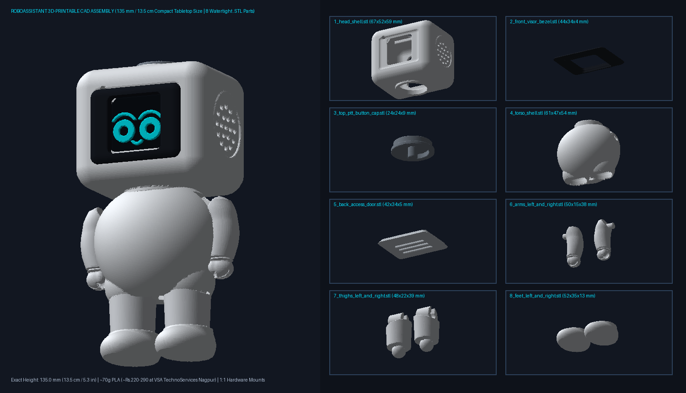

# 🤖 RoboAssistant — 3D-Printable Enclosure & CAD Package (`135 mm` / `13.5 cm` Compact Tabletop Edition, 8 Modular `.STL` Parts)

<p align="center">
  
</p>

This folder contains the parametric 3D-printable enclosure for **RoboAssistant (`135.0 mm` / `13.5 cm` / `5.31 inches` tall)**, modeled directly after [`docs/images/robot_hero.jpg`](../docs/images/robot_hero.jpg) with **movable hip joints, swivel/tilt ankle joints, and movable shoulder joints**, while keeping **100% 1:1 internal hardware mounts** for all components in [`README.md`](../README.md):

* **MCU**: `VIREXON ESP32-S3-WROOM-1-N16R8` (`HW678 V0.0.0`, `28.5 × 65 mm` PCB)
* **Face Display**: `1.3" 240×240 RGB TFT IPS 7-Pin ST7789` (`B0G4F3XGYY`, `26.5 × 26.5 mm` active area, `35.5 × 39.0 mm` PCB)
* **Speaker**: `Electrobot 48mm (2-Inch) 8Ω 3W Speaker` (`B0HLH3VTNK`)
* **Microphone & Amp**: `INMP441` 6-Pin MEMS Mic + `MAX98357A` 3W Class-D Amp (`B0H5X6RNPW`)
* **Top Push-to-Talk Button**: `6×6×6mm` 4-Pin Momentary Tactile Switch (`B0H3PVBZ7D` on `GPIO 1`)
* **Dual-Mode Servo Bays (`SG90`)**: Pre-molded right-shoulder `SG90` socket (`GPIO 18` `[WAVE]` arm) + left/right lower pelvis `SG90` hip servo bays for optional motorized walking/dancing.

---

## 📦 1. Ready-to-Print `.STL` Files (`cad/stl/`)

You can send or hand-deliver these **8 watertight `.STL` files** directly to **[VSA TechnoServices (3D Printing & Prototyping — Manish Nagar / Ujjwal Nagar, Nagpur)](https://share.google/9JBsJbK4BvrGDEVgq)** or upload them to any online 3D printing service in India (such as **Robu.in Online 3D Printing**):

| File Path | Dimensions (`X × Y × Z`) | Slicer PLA Weight (`15%` Infill) | Recommended Filament Color | Purpose & Internal Features |
| :--- | :---: | :---: | :---: | :--- |
| [`stl/1_head_shell.stl`](stl/1_head_shell.stl) | `67.2 × 52.0 × 59.2 mm` | `~37.6 g` | **Matte White PLA** | Compact rounded squircle head (`5.5 cm` body height) with:<ul><li>Front `26.6 × 26.6 mm` `1.3" ST7789` 1:1 window + internal `35.5 × 39.0 mm` PCB guide rails</li><li>Right & Left "Ear" 19-hole honeycomb acoustic grilles + internal `48.6 mm` ID collar for the `2-Inch 8Ω 3W` speaker</li><li>Top button collar + internal bridge holding the `6×6mm` tactile switch</li><li>Left-cheek `3.0 mm` pinhole + internal **acoustic isolation collar** for the `INMP441` mic</li></ul> |
| [`stl/2_front_visor_bezel.stl`](stl/2_front_visor_bezel.stl) | `44.3 × 34.3 × 4.3 mm` | `~2.7 g` | **Matte Black PLA** | Snap-in front visor bezel that frames the `1.3" ST7789` display and gives the signature black-face contrast from `robot_hero.jpg`. |
| [`stl/3_top_ptt_button_cap.stl`](stl/3_top_ptt_button_cap.stl) | `23.6 × 23.6 × 8.8 mm` | `~1.8 g` | **Cool Grey / Cyan PLA** | Circular top actuator cap (`21.2 mm` top diameter) with retention flange and center plunger (`1.2 mm` travel stop) that presses the `6×6mm` `GPIO 1` tactile button. |
| [`stl/4_torso_shell.stl`](stl/4_torso_shell.stl) | `60.6 × 47.4 × 53.9 mm` | `~23.2 g` | **Matte White PLA** | **Compact Oval/Egg Chubby Belly (`2.2 mm` Lightweight Shell)** + angled crescent hip sockets with:<ul><li>Internal vertical `28.8 mm` PCB guide rails for `ESP32-S3 N16R8` (`HW678 V0.0.0`)</li><li>Hollow neck wire-routing channel (`23.6 mm` ID) for `Male-to-Female` ribbon jumper wires</li><li>Left & Right `5.8 mm` shoulder pivot sockets + right-shoulder `SG90` servo pocket (`23.2 × 12.6 mm`)</li><li>Heavy-duty **`Ø7.0 mm` Hip Pivot Axles with `0°` standing & `90°` sitting click-detent ridges** + internal **`SG90` Hip Servo Bays**</li><li>Lower-rear USB-C cable access port (`15 × 8.4 mm`)</li></ul> |
| [`stl/5_back_access_door.stl`](stl/5_back_access_door.stl) | `41.6 × 33.6 × 4.8 mm` | `~4.0 g` | **Matte White PLA** | Snap-fit rear service door with 3 ventilation louvers. |
| [`stl/6_arms_left_and_right.stl`](stl/6_arms_left_and_right.stl) | `50.0 × 14.7 × 37.9 mm` | `~5.4 g` | **Matte White PLA** | Pair of smooth banana-curved tapered arms with flush angled shoulder joints, crisp wrist seam grooves, sculpted front-inner thumbs, inward-curled fingers, and `5.2 mm` shoulder pivot pegs. |
| [`stl/7_thighs_left_and_right.stl`](stl/7_thighs_left_and_right.stl) | `47.9 × 22.4 × 38.7 mm` | `~10.0 g` | **Matte White PLA** | Pair of **cylindrical hip-pivot thighs** (hollowed for low PLA weight) with diagonal pelvis saddle seams (`/   \`), recessed internal hip pivot turrets (`Ø7.5 mm` bore + click-detents for `0°` standing & `90°` sitting), and bottom spherical/keyed ankle studs hidden inside the shoe collar. |
| [`stl/8_feet_left_and_right.stl`](stl/8_feet_left_and_right.stl) | `52.2 × 34.8 × 12.7 mm` | `~7.4 g` | **Matte White PLA** | Pair of **domed sneaker-pod swivel/tilt shoes** with wraparound raised ankle collar rims, wide flat soles, and top snap-in ankle sockets (`0°` flat-standing lock detent + stride tilt slots) so the feet stay flat on your desk even when posed in a walking stride! |

---

## 🖨️ 2. Recommended 3D Printer / Service Settings

When ordering from an online or local 3D printing shop, specify:
* **Material**: Standard **PLA** or **PLA+** (Matte White for parts `1, 4, 5, 6, 7, 8`, Matte Black for part `2`, Grey/Cyan for part `3`).
* **Layer Height**: `0.20 mm`
* **Wall / Perimeter Count**: `2–3 walls` (`0.8 – 1.2 mm` shell)
* **Infill**: `15% Gyroid` or `Grid`
* **Supports**: **Tree Supports (Touching Buildplate Only)** for `1_head_shell.stl`, `4_torso_shell.stl`, and `7_thighs_left_and_right.stl`; **No Supports** needed for `2_front_visor_bezel.stl`, `3_top_ptt_button_cap.stl`, `5_back_access_door.stl`, and `8_feet_left_and_right.stl`.
* **Estimated Total Filament Weight**: **`~92g` sliced PLA** (`97.3 cm³` total CAD volume, down more than 53% from the 180mm version — only **`~₹230 – ₹320`** at standard Indian 3D print rates!).

---

## 🔧 3. How to Assemble the Electronics & Movable Limbs

1. **Snap Together the Movable Lower Body (`4_torso_shell.stl` + `7_thighs` + `8_feet`)**:
   * Press the bottom ankle ball of each thigh (**`7_thighs_left_and_right.stl`**) down into the ankle socket of each shoe (**`8_feet_left_and_right.stl`**) until it clicks.
   * Push the top C-fork hip socket of each thigh onto the `Ø8.0 mm` hip axles of **`4_torso_shell.stl`**. Rotate to `0°` (vertical click-detent) for rock-solid standing, tilt one leg forward (`±25°`) for a walking stride while keeping both shoes flat on the table, or rotate both legs `90°` forward to sit the robot on the edge of your desk!
2. **Mount the Head Components (`1_head_shell.stl`)**:
   * Drop **`3_top_ptt_button_cap.stl`** into the top hole from the *inside* of the head, then push your **`6×6mm` tactile button** (`GPIO 1`) into the internal bridge cradle right underneath the plunger.
   * Slide your **`1.3" ST7789` 7-Pin Display** into the internal front guide rails (screen facing forward) and snap **`2_front_visor_bezel.stl`** into the front visor recess.
   * Press the **`INMP441` Microphone** (gold acoustic hole facing out through the left-cheek pinhole!) into the internal circular isolation collar.
   * Seat the **`48mm 8Ω 3W` Speaker** into the right-ear internal `49.0 mm` retention collar.
3. **Route the `Male-to-Female` Ribbon Wires & Mount Torso Electronics**:
   * Pass the jumper wires from the Display, Mic, Speaker, and Top Button down through the hollow neck channel into **`4_torso_shell.stl`**.
   * Slide your **`ESP32-S3` (`HW678 V0.0.0`)** into the internal torso rails with the **LEFT USB-C port (`USB`)** facing down toward the rear USB-C cable slot, place the **`MAX98357A`** and **`1000µF 25V` Capacitor** in the side pocket, snap on the **Arms (`6_arms_left_and_right.stl`)**, and close the rear hatch with **`5_back_access_door.stl`**!

---

## 🔄 4. Re-Generating or Customizing Dimensions

If you ever want to tweak a dimension, wall thickness, or tolerance, edit [`generate_robot_stl.py`](generate_robot_stl.py) and run:

```powershell
python cad/generate_robot_stl.py
```
