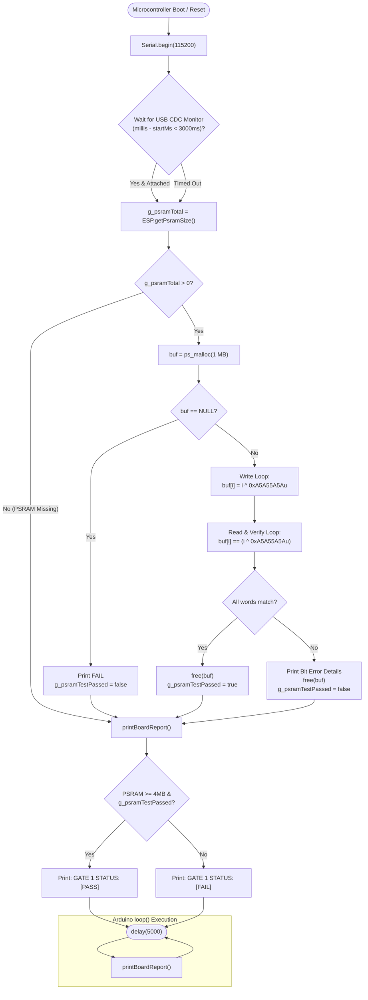

# 🔄 Gate 1: Board, Flash & Octal PSRAM Diagnostic — Execution Flow & Functions

## 📋 1. Overview
`gate1_board/main.cpp` is the initial hardware verification firmware for the ESP32-S3. It verifies chip silicon, flash memory, Octal PSRAM allocation, and runs a 1 MB read/write bit-integrity test to prove that the high-speed PSRAM bus (`qio_opi`) is completely stable.

---

## 🛠️ 2. Comprehensive Function & Variable Inventory

### Global Variables
* `static bool g_psramTestPassed`: Stores the boolean result of the 1 MB PSRAM write-and-verify test.
* `static size_t g_psramTotal`: Total detected PSRAM size in bytes from `ESP.getPsramSize()`.

### Functions
1. `static const char* resetReasonToString(esp_reset_reason_t reason)`
   * **Purpose**: Converts the low-level ESP-IDF `esp_reset_reason_t` enum into human-readable text.
   * **Handled Reasons**: `POWERON_RESET`, `SOFTWARE_RESET`, `EXCEPTION_PANIC`, `TASK_WATCHDOG`, `BROWNOUT_RESET` (warns user if 5V USB rail dipped below threshold), and `OTHER_RESET`.
2. `static bool runPsramIntegrityTest()`
   * **Purpose**: Dynamically allocates 1 MB (`1024 * 1024` bytes) in Octal PSRAM via `ps_malloc()`.
   * **Algorithm**:
     1. Fills `uint32_t` words using a deterministic bit-flipping pattern: `buf[i] = i ^ 0xA5A55A5Au`.
     2. Reads back each word and compares against expected value.
     3. If any bit error is detected, logs the exact word index, actual vs expected bitfield, and returns `false`.
     4. Calls `free(buf)` and returns `true` on success.
3. `static void printBoardReport()`
   * **Purpose**: Prints an exhaustive system telemetry banner to Serial.
   * **Metrics Reported**:
     * Hardware reset reason
     * Chip model, silicon revision, core count, CPU clock frequency (240 MHz)
     * SPI Flash size (16 MB or 8 MB)
     * Internal SRAM heap (Free vs Total)
     * Octal PSRAM capacity and free bytes
     * Final verdict banner: `[PASS]` if PSRAM >= 4 MB and integrity test passed, else `[FAIL]`.
4. `void setup()`
   * **Purpose**: Initializes USB CDC Serial, queries PSRAM hardware, executes integrity test, and outputs report.
5. `void loop()`
   * **Purpose**: Re-evaluates heap stability every 5,000 ms (`delay(5000)`) and reprints the diagnostic report.

---

## 📊 3. Mermaid Control Flowchart

