# 🔄 Gate 2: ST7789 SPI Display & PSRAM Sprite Renderer — Execution Flow & Functions

## 📋 1. Overview
`gate2_display/main.cpp` verifies the ST7789 240x240 IPS Color Display driven by LovyanGFX over 40 MHz SPI (`SPI2_HOST`). It demonstrates non-blocking double-buffered rendering by allocating a 240x110 16-bit RGB565 sprite in Octal PSRAM and pushing partial bounding-box eye updates at > 30 FPS with animated blinking and pupil saccades.

---

## 🛠️ 2. Comprehensive Function, Class & Variable Inventory

### Constants & Configuration
* `EYE_BAND_W = 240`: Width of the eye animation region in pixels.
* `EYE_BAND_H = 110`: Height of the partial eye bounding box in pixels.
* `EYE_BAND_Y = 65`: Vertical Y-offset on the 240x240 display where the sprite is pushed.

### Classes
1. `class RobotDisplay : public lgfx::LGFX_Device`
   * **Sub-modules**:
     * `lgfx::Panel_ST7789 _panel`: Configures display dimensions (240x240), color inversion (`invert = true` for IPS), offsets, and pin ties.
     * `lgfx::Bus_SPI _bus`: Configures `SPI2_HOST` at 40 MHz write clock, SPI Mode 3 (or Mode 0 for 8-pin with CS), auto DMA channel, `SCLK = GPIO 12`, `MOSI = GPIO 11`, `DC = GPIO 9`.
     * `lgfx::Light_PWM _light`: Configures backlight brightness control on `GPIO 13` with 12 kHz PWM on channel 7.
   * **Constructor**: Assembles bus, panel, and backlight configurations into the unified LGFX device.

### Global Instances & Variables
* `static RobotDisplay g_tft`: Global instance of the configured LovyanGFX display driver.
* `static lgfx::LGFX_Sprite g_eyeSprite(&g_tft)`: Offscreen double-buffer canvas backed by Octal PSRAM.
* `static uint32_t g_frameCount`: Frame counter incremented on every render pass.
* `static uint32_t g_lastFpsMs`: Timestamp of the last FPS calculation interval.

### Functions
1. `static void drawRobotEyes(int eyeHeight, int pupilOffsetX, int pupilOffsetY)`
   * **Purpose**: Clears the PSRAM sprite with `TFT_BLACK`, calculates geometric rounded rectangles for left and right eyes based on dynamic height (blinking) and horizontal offset (pupil tracking), draws bright cyan eyes (`RGB565: 0, 220, 255`), and executes `pushSprite(0, EYE_BAND_Y)` to transfer only the 240x110 band via SPI DMA.
2. `void setup()`
   * **Purpose**:
     * Initializes USB CDC Serial with a 3-second attachment timeout.
     * Initializes display hardware: `g_tft.init()`, rotation `0`, brightness `220/255`, screen clear `TFT_BLACK`.
     * Allocates the 240x110 16-bit sprite buffer in PSRAM via `g_eyeSprite.setPsram(true)`.
     * Traps in an error loop if PSRAM allocation fails.
     * Initializes FPS calculation timers.
3. `void loop()`
   * **Purpose**:
     * Calculates mathematical eye height based on a 3,200 ms periodic blink waveform (160 ms blink window: 80 ms close, 80 ms open).
     * Calculates saccade pupil horizontal shifts every 4,000 ms (-10 px look left, 0 center, +10 px look right).
     * Calls `drawRobotEyes()`.
     * Measures rendering speed every 2,000 ms and logs sustained FPS and free PSRAM to Serial.
     * Regulates frame pacing via `delay(16)` to target ~35–45 FPS.

---

## 📊 3. Mermaid Control Flowchart

```mermaid
flowchart TD
    Start(["System Boot"]) --> InitSerial["Serial.begin(115200)"]
    InitSerial --> WaitCDC{"USB CDC Attached?<br/>(within 3000ms)"}
    WaitCDC --> InitTFT["g_tft.init()<br/>setRotation(0)<br/>setBrightness(220)<br/>fillScreen(TFT_BLACK)"]

    InitTFT --> SpriteAlloc["g_eyeSprite.setPsram(true)<br/>g_eyeSprite.setColorDepth(16)<br/>createSprite(240, 110)"]
    SpriteAlloc --> CheckAlloc{"Sprite Created in PSRAM?"}
    CheckAlloc -- No --> FailLoop["Print [FAIL]<br/>while(true) delay(1000)"]
    CheckAlloc -- Yes --> PrintOK["Print [OK] & Free PSRAM<br/>g_lastFpsMs = millis()"]

    PrintOK --> LoopCycle

    subgraph Loop ["Arduino loop() Rendering Engine"]
        LoopCycle(["Loop Start: now = millis()"]) --> BlinkCalc["Calculate Blink Cycle (now % 3200ms):<br/>0..80ms: close eyeH (68 -> 6)<br/>80..160ms: open eyeH (6 -> 68)<br/>160..3200ms: wide open (68)"]
        BlinkCalc --> SaccadeCalc["Calculate Saccade Phase ((now/2000) % 4):<br/>Phase 1: look left (-10px)<br/>Phase 3: look right (+10px)<br/>Phase 0,2: center (0px)"]
        SaccadeCalc --> Draw["drawRobotEyes(eyeH, offsetX, 0)"]
        
        subgraph DrawSub ["drawRobotEyes() Detail"]
            Draw --> ClearSprite["g_eyeSprite.fillScreen(TFT_BLACK)"]
            ClearSprite --> GeomCalc["Compute Left/Right Eye Centers & Radii"]
            GeomCalc --> RenderEyes["fillRoundRect(Left Eye, Cyan)<br/>fillRoundRect(Right Eye, Cyan)"]
            RenderEyes --> Push["pushSprite(0, EYE_BAND_Y)<br/>(Transfers 240x110 to SPI2_HOST DMA)"]
        end

        Push --> IncFrame["g_frameCount++"]
        IncFrame --> CheckFps{"now - g_lastFpsMs >= 2000ms?"}
        CheckFps -- Yes --> CalcPrintFps["fps = (frameCount * 1000) / elapsed<br/>Print FPS & Free PSRAM<br/>Reset frameCount & lastFpsMs"] --> DelayFrame["delay(16) (~35-45 FPS)"]
        CheckFps -- No --> DelayFrame
        DelayFrame --> LoopCycle
    end
```

