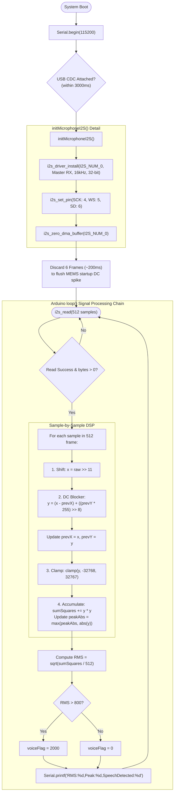

# 🔄 Gate 3: INMP441 Microphone & DC-Blocker Filter — Execution Flow & Functions

## 📋 1. Overview
`gate3_mic/main.cpp` verifies the INMP441 omnidirectional digital MEMS microphone connected to `I2S_NUM_0` in RX master mode at 16 kHz with 32-bit slots. It processes 32 ms audio frames, applies an arithmetic bit-shift to extract the 24-bit audio word into standard 16-bit signed PCM, runs a 1st-order IIR DC-blocking high-pass filter, calculates RMS energy and peak amplitude, and outputs formatted data for the Arduino / PlatformIO Serial Plotter.

---

## 🛠️ 2. Comprehensive Function & Variable Inventory

### Constants & Configuration
* `MIC_I2S_PORT = I2S_NUM_0`: Hardware I2S controller assigned exclusively to audio capture.
* `MIC_SAMPLE_RATE = 16000`: 16,000 samples per second (speech standard).
* `FRAME_SAMPLES = 512`: Number of samples per processing window (32 ms @ 16 kHz).
* `MIC_BIT_SHIFT = 11`: Arithmetic right-shift (`sample >> 11`) to scale 24-bit-in-32-bit slot audio down to `int16_t` range with 6 dB headroom.
* `VAD_RMS_THRESHOLD = 800`: Fixed threshold above ambient noise floor to flag active speech.

### Global Variables
* `static int32_t g_rawSamples[FRAME_SAMPLES]`: Buffer for reading raw 32-bit I2S DMA frames.
* `static int32_t g_prevX`: History state $x[n-1]$ for the first-order difference filter.
* `static int32_t g_prevY`: History state $y[n-1]$ for the recursive IIR leaky integrator.

### Functions
1. `static void initMicrophoneI2S()`
   * **Purpose**: Installs the ESP-IDF I2S driver on `I2S_NUM_0` in Master RX mode.
   * **Configuration**:
     * 32 bits per sample, Left channel only (`I2S_CHANNEL_FMT_ONLY_LEFT`).
     * Standard I2S communication format (`I2S_COMM_FORMAT_STAND_I2S`).
     * 6 DMA buffers with 256 words each.
     * Pins: `bck_io_num = PIN_MIC_BCLK (4)`, `ws_io_num = PIN_MIC_WS (5)`, `data_in_num = PIN_MIC_SD (6)`.
     * Flushes DMA buffer on completion: `i2s_zero_dma_buffer(MIC_I2S_PORT)`.
2. `void setup()`
   * **Purpose**:
     * Initializes USB CDC Serial.
     * Calls `initMicrophoneI2S()`.
     * **MEMS Startup Transient Flush**: Reads and discards 6 consecutive frames (~200 ms) of audio to prevent initial power-on DC pop from corrupting the baseline.
3. `void loop()`
   * **Purpose**:
     * Reads `FRAME_SAMPLES * sizeof(int32_t)` bytes from `I2S_NUM_0` via `i2s_read()`.
     * Iterates through every sample:
       1. Shifts right by 11 bits: `x = raw >> 11`.
       2. Executes fixed-point 1st-order IIR DC-blocking filter:
          $$y[n] = (x[n] - x[n-1]) + \frac{255 \cdot y[n-1]}{256}$$
       3. Updates filter state variables `g_prevX` and `g_prevY`.
       4. Clamps output to signed 16-bit bounds: $[-32768, 32767]$.
       5. Tracks `peakAbs` and accumulates `sumSquares += y * y`.
     * Computes RMS: $\text{RMS} = \sqrt{\frac{\sum y^2}{N}}$.
     * Sets speech detection indicator: $2000$ if $\text{RMS} > 800$, else $0$.
     * Prints formatted telemetry: `RMS:<rms>,Peak:<peak>,SpeechDetected:<flag>`.

---

## 📊 3. Mermaid Control Flowchart

