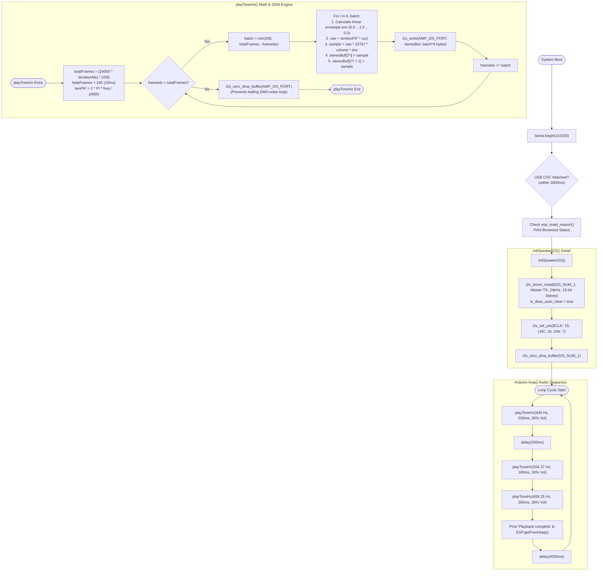

# 🔄 Gate 4: MAX98357A Speaker & Power Stability Test — Execution Flow & Functions

## 📋 1. Overview
`gate4_speaker/main.cpp` verifies the MAX98357A I2S Class-D mono amplifier and 8Ω speaker connected to `I2S_NUM_1` in TX master mode at 24 kHz (matching OpenAI/Gemini TTS playback). It verifies that audio plays cleanly without brownout resets on USB-C power, duplicates mono audio into interleaved stereo slots `[L, R]` to support all MAX98357A clone boards, applies a 10 ms click-free fade envelope, and flushes the DMA ring buffer on exit.

---

## 🛠️ 2. Comprehensive Function & Variable Inventory

### Constants & Configuration
* `AMP_I2S_PORT = I2S_NUM_1`: Hardware I2S controller assigned exclusively to audio playback.
* `AMP_SAMPLE_RATE = 24000`: 24,000 samples per second (TTS standard).
* `SOFTWARE_VOLUME = 0.30f`: Initial safe test volume (30%) to prevent sudden loud blasts.
* `CHUNK_FRAMES = 256`: Number of stereo sample pairs processed per batch.

### Functions
1. `static void initSpeakerI2S()`
   * **Purpose**: Installs the ESP-IDF I2S driver on `I2S_NUM_1` in Master TX mode.
   * **Configuration**:
     * 16 bits per sample, Stereo `[Right, Left]` slots (`I2S_CHANNEL_FMT_RIGHT_LEFT`).
     * Standard I2S communication format (`I2S_COMM_FORMAT_STAND_I2S`).
     * `tx_desc_auto_clear = true`: Automatically zeroes the DMA descriptor on buffer underrun to prevent old audio looping.
     * 6 DMA buffers with 256 frames each.
     * Pins: `bck_io_num = PIN_AMP_BCLK (15)`, `ws_io_num = PIN_AMP_LRC (16)`, `data_out_num = PIN_AMP_DIN (7)`.
     * Zeroes DMA buffer: `i2s_zero_dma_buffer(AMP_I2S_PORT)`.
2. `static void playToneHz(float freqHz, uint32_t durationMs, float volume)`
   * **Purpose**: Synthesizes and plays a pure sine wave tone of arbitrary frequency and duration.
   * **Anti-Click Envelope Protection**:
     * Calculates `fadeFrames = AMP_SAMPLE_RATE / 100` (10 ms).
     * Applies linear ramp-up $0.0 \to 1.0$ over the first 10 ms.
     * Applies linear ramp-down $1.0 \to 0.0$ over the last 10 ms.
   * **Stereo Channel Duplication**:
     * Stores each calculated mono sample into both `stereoBuf[i * 2]` (Left) and `stereoBuf[i * 2 + 1]` (Right), guaranteeing sound regardless of whether the physical board wires `SD_MODE` to left, right, or mix.
   * **Exit Guardrail**: Calls `i2s_zero_dma_buffer(AMP_I2S_PORT)` immediately upon completion.
3. `void setup()`
   * **Purpose**:
     * Initializes USB CDC Serial.
     * Inspects and logs `esp_reset_reason()`, specifically checking whether the last restart was caused by `ESP_RST_BROWNOUT`.
     * Calls `initSpeakerI2S()`.
4. `void loop()`
   * **Purpose**:
     * Plays a 440 Hz standard A reference tone for 500 ms.
     * Delays 250 ms.
     * Plays a pleasant two-note robot chime: 554.37 Hz (C#5, 180 ms) followed by 659.25 Hz (E5, 260 ms).
     * Prints free heap.
     * Pauses for 4,000 ms before repeating.

---

## 📊 3. Mermaid Control Flowchart

