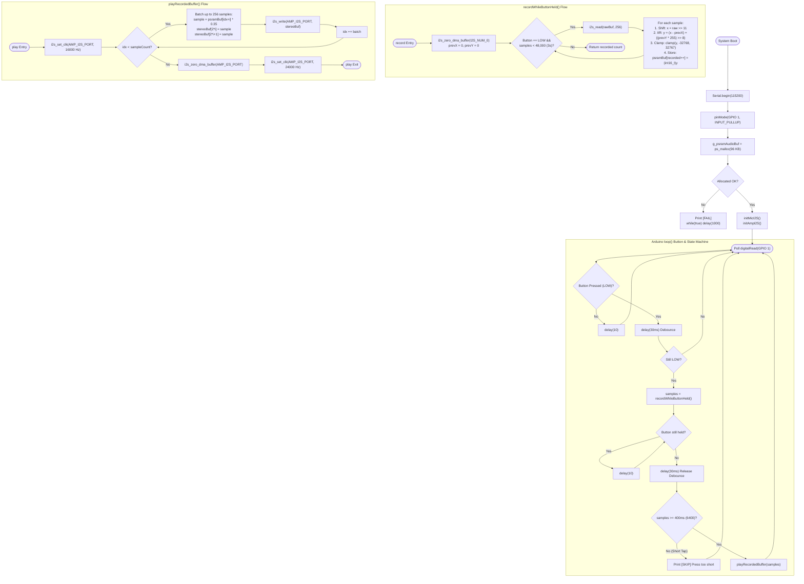

# 🔄 Gate 5: PSRAM Record & Playback Loopback — Execution Flow & Functions

## 📋 1. Overview
`gate5_loopback/main.cpp` combines the INMP441 digital microphone (`I2S_NUM_0`), the MAX98357A audio amplifier (`I2S_NUM_1`), Octal PSRAM, and the Push-to-Talk tactile button (`GPIO 1`). It records 16 kHz mono PCM into a 96 KB PSRAM buffer while the button is held down (up to 3 seconds), dynamically switches the speaker I2S clock from 24 kHz to 16 kHz (`i2s_set_clk`), plays back the user's recorded voice, and restores the clock.

---

## 🛠️ 2. Comprehensive Function & Variable Inventory

### Constants & Configuration
* `LOOPBACK_SAMPLE_RATE = 16000`: Unified 16 kHz recording and playback rate.
* `MAX_RECORD_SECONDS = 3`: Maximum record duration limit.
* `MAX_RECORD_SAMPLES = 48000`: 48,000 samples ($48000 \times 2\text{ bytes} = 96\text{ KB}$ in PSRAM).
* `MIN_VALID_SAMPLES = 6400`: 400 ms minimum utterance threshold to ignore accidental button clicks.
* `IO_CHUNK_SAMPLES = 256`: DMA chunk size.
* `MIC_BIT_SHIFT = 11`: 24-bit to 16-bit word scaling shift.
* `PLAYBACK_VOLUME = 0.35f`: Scaled playback volume (35%).

### Global Variables
* `static int16_t* g_psramAudioBuf`: Pointer to the 96 KB audio buffer allocated in Octal PSRAM.
* `static int32_t g_prevX`: History state $x[n-1]$ for the microphone DC-blocking filter.
* `static int32_t g_prevY`: History state $y[n-1]$ for the microphone DC-blocking filter.

### Functions
1. `static void initMicI2S()`
   * **Purpose**: Installs the I2S driver for `I2S_NUM_0` in Master RX mode at 16 kHz, 32-bit slot, Left channel.
   * **Pins**: `PIN_MIC_BCLK (4)`, `PIN_MIC_WS (5)`, `PIN_MIC_SD (6)`.
2. `static void initAmpI2S()`
   * **Purpose**: Installs the I2S driver for `I2S_NUM_1` in Master TX mode, 16-bit stereo slots, with `tx_desc_auto_clear = true`.
   * **Pins**: `PIN_AMP_BCLK (15)`, `PIN_AMP_LRC (16)`, `PIN_AMP_DIN (7)`.
3. `static size_t recordWhileButtonHeld()`
   * **Purpose**: Continuously captures audio samples while `PIN_PTT_BTN (GPIO 1)` remains `LOW` and `recordedSamples < MAX_RECORD_SAMPLES`.
   * **Algorithm**:
     1. Flushes stale mic DMA buffer via `i2s_zero_dma_buffer(MIC_I2S_PORT)`.
     2. Resets filter history `g_prevX = 0, g_prevY = 0`.
     3. In a loop, reads chunks of 32-bit words via `i2s_read()`.
     4. Shifts right by 11 bits, applies the 1st-order IIR DC-blocker, clamps to `[-32768, 32767]`, and appends `int16_t` samples into `g_psramAudioBuf`.
     5. Returns total recorded sample count.
4. `static void playRecordedBuffer(size_t sampleCount)`
   * **Purpose**: Plays the audio buffer back through the MAX98357A speaker amplifier.
   * **Clock Matching**: Calls `i2s_set_clk(AMP_I2S_PORT, 16000, 16-bit, stereo)` to ensure pitch-accurate 16 kHz playback.
   * **Duplication**: Replicates mono PSRAM samples into interleaved stereo `[L, R]` pairs with `PLAYBACK_VOLUME` scaling.
   * **Exit Guardrail**: Calls `i2s_zero_dma_buffer(AMP_I2S_PORT)` and restores the standard 24 kHz clock via `i2s_set_clk()`.
5. `void setup()`
   * **Purpose**:
     * Initializes USB CDC Serial.
     * Configures `PIN_PTT_BTN (GPIO 1)` with `INPUT_PULLUP`.
     * Allocates 96 KB in Octal PSRAM via `ps_malloc()`. Traps on failure.
     * Initializes both mic (`I2S_NUM_0`) and amp (`I2S_NUM_1`) drivers.
6. `void loop()`
   * **Purpose**:
     * Polls `PIN_PTT_BTN`.
     * If `LOW`, delays 30 ms for mechanical switch contact debounce.
     * If still `LOW`, calls `recordWhileButtonHeld()`.
     * Waits for button release if 3-second cap was hit while still pressed, followed by a 30 ms release debounce.
     * Evaluates `sampleCount`:
       * If $< \text{MIN\_VALID\_SAMPLES}$ (400 ms), prints `[SKIP]` (accidental tap).
       * If $\ge \text{MIN\_VALID\_SAMPLES}$, calls `playRecordedBuffer()`.

---

## 📊 3. Mermaid Control Flowchart

