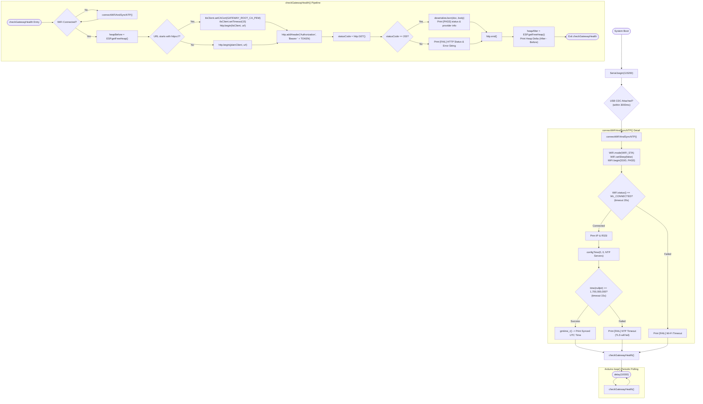

# 🔄 Gate 6: Wi-Fi, NTP Sync & Verified TLS `/health` — Execution Flow & Functions

## 📋 1. Overview
`gate6_health/main.cpp` verifies network connectivity, cryptographic certificate validation, and memory safety:
1. Connects to 2.4 GHz Wi-Fi with modem sleep disabled (`WiFi.setSleep(false)`) to minimize audio streaming latency.
2. Synchronizes system UTC time using SNTP (`pool.ntp.org`, `time.cloudflare.com`) and enforces `time(nullptr) >= 1,700,000,000` (year > 2024) before attempting any TLS handshake.
3. Performs a strictly verified HTTPS GET request to the Gateway `/health` endpoint using `WiFiClientSecure` and `GATEWAY_ROOT_CA_PEM` (never using `setInsecure()`).
4. Parses the JSON response using `ArduinoJson` and audits heap deltas to verify zero TLS memory leaks.

---

## 🛠️ 2. Comprehensive Function & Variable Inventory

### Functions
1. `static void connectWiFiAndSyncNTP()`
   * **Purpose**: Manages station-mode Wi-Fi connection and NTP clock synchronization.
   * **Algorithm**:
     1. Sets `WiFi.mode(WIFI_STA)` and `WiFi.setSleep(false)`.
     2. Initiates `WiFi.begin(WIFI_SSID, WIFI_PASSWORD)`.
     3. Polls connection status with a 20-second timeout.
     4. Logs local IP address and Wi-Fi signal strength (RSSI).
     5. Configures SNTP via `configTime(0, 0, "pool.ntp.org", "time.cloudflare.com")`.
     6. Polls `time(nullptr)` until epoch time exceeds $1,700,000,000$ (with a 15-second timeout).
     7. Formats and prints synced UTC calendar time via `gmtime_r()`.
2. `static void checkGatewayHealth()`
   * **Purpose**: Executes the authenticated health check against the Gateway server.
   * **Algorithm**:
     1. Verifies Wi-Fi is connected; attempts reconnection via `connectWiFiAndSyncNTP()` if disconnected.
     2. Records pre-request heap: `heapBefore = ESP.getFreeHeap()`.
     3. Constructs endpoint URL: `String(GATEWAY_BASE_URL) + "/health"`.
     4. Protocol branch:
        * If `https://`: configures `WiFiClientSecure` with `tlsClient.setCACert(GATEWAY_ROOT_CA_PEM)` and 15s timeout.
        * If `http://`: binds plain `WiFiClient`.
     5. Adds HTTP Header: `Authorization: Bearer <GATEWAY_BEARER_TOKEN>`.
     6. Executes `http.GET()`.
     7. If HTTP 200: Deserializes JSON with `JsonDocument doc`, extracts `status` and `providers.llm`, and logs `[PASS]`.
     8. Else: Logs status code and error description.
     9. Closes HTTP connection via `http.end()`.
     10. Computes post-request heap delta: `heapAfter - heapBefore`, proving zero memory leak.
3. `void setup()`
   * **Purpose**: Initializes USB CDC Serial, logs diagnostic banner, and runs initial Wi-Fi, NTP, and `/health` test.
4. `void loop()`
   * **Purpose**: Pauses for 10,000 ms (`delay(10000)`) and runs periodic health checks to test long-term TLS socket stability.

---

## 📊 3. Mermaid Control Flowchart

