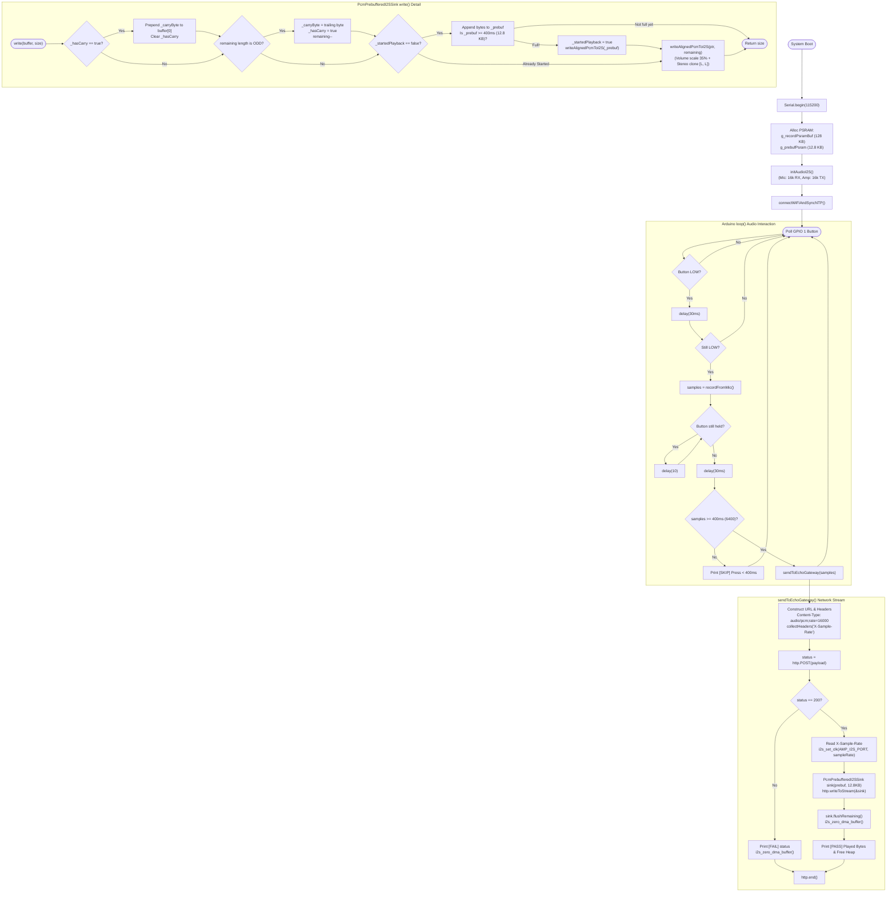

# 🔄 Gate 7: Raw PCM Upload & Chunked Echo Playback — Execution Flow & Functions

## 📋 1. Overview
`gate7_echo/main.cpp` verifies the complete bi-directional network audio pipeline without artificial intelligence. It records up to 4 seconds of raw 16 kHz mono PCM into PSRAM upon holding the `GPIO 1` button, sends an authenticated `POST` request to the Gateway `/echo` endpoint over verified TLS, reads response headers (`X-Sample-Rate`), streams back chunk-encoded audio through a custom `Stream` sink with a 1-byte odd-chunk carryover guard, buffers 400 ms in Octal PSRAM before playback, and plays the audio via `I2S_NUM_1` through the MAX98357A speaker.

---

## 🛠️ 2. Comprehensive Function, Class & Variable Inventory

### Constants & Configuration
* `MIC_SAMPLE_RATE = 16000`: 16 kHz recording clock.
* `MAX_RECORD_SECONDS = 4`: 4-second maximum speech recording limit.
* `MAX_RECORD_SAMPLES = 64000`: 64,000 samples ($128\text{ KB}$ in PSRAM).
* `MIN_VALID_SAMPLES = 6400`: 400 ms minimum button press duration.
* `IO_CHUNK_SAMPLES = 256`: DMA processing frame size.
* `PREBUFFER_BYTES = 12800`: 400 ms pre-buffer capacity at 16 kHz ($16000 \times 2 \times 0.4 = 12,800\text{ bytes}$).

### Global Pointers & State
* `static int16_t* g_recordPsramBuf`: Buffer for recording PCM audio.
* `static uint8_t* g_prebufPsram`: Buffer for pre-buffering streaming audio before DMA release.
* `static int32_t g_prevX`, `static int32_t g_prevY`: DC-blocking filter state.

### Classes
1. `class PcmPrebufferedI2SSink : public Stream`
   * **Purpose**: Custom Stream sink consumed by `http.writeToStream(&sink)`.
   * **Critical Guardrails**:
     * `_hasCarry` / `_carryByte`: Holds back 1 trailing byte if an incoming HTTP chunk has an odd byte length, preventing byte-alignment corruption (which causes deafening high-pitched static).
     * `_prebuf` / `_prebufLen`: Accumulates 400 ms of audio in PSRAM before enabling I2S DMA playback, preventing buffer underrun clicks caused by network jitter.
     * `writeAlignedPcmToI2S(data, evenLen)`: Scales samples by `PLAYBACK_VOLUME (0.35)`, duplicates mono samples into stereo `[L, R]`, and writes to `I2S_NUM_1`.
     * `flushRemaining()`: Plays any residual audio in the pre-buffer if total stream size was smaller than 400 ms, and calls `i2s_zero_dma_buffer(AMP_I2S_PORT)`.
     * `totalPlayedBytes()`: Returns cumulative bytes written to speaker.

### Functions
1. `static void initAudioI2S()`
   * **Purpose**: Initializes `I2S_NUM_0` (16 kHz RX, 32-bit slot, Left channel) and `I2S_NUM_1` (16 kHz TX, 16-bit stereo slots, auto-clear DMA descriptors).
2. `static bool connectWiFiAndSyncNTP()`
   * **Purpose**: Connects to 2.4 GHz Wi-Fi with modem sleep disabled and validates NTP time sync before TLS transactions. Returns `true` if connected and epoch $\ge 1,700,000,000$.
3. `static size_t recordFromMic()`
   * **Purpose**: Captures audio into `g_recordPsramBuf` while `PIN_PTT_BTN` is held, applying bit-shift and DC-blocking filter.
4. `static void sendToEchoGateway(size_t sampleCount)`
   * **Purpose**:
     1. Re-verifies network connection.
     2. Configures `HTTPClient` with `tlsClient.setCACert(GATEWAY_ROOT_CA_PEM)`.
     3. Registers header collection for `X-Sample-Rate`.
     4. Sets `Authorization: Bearer <TOKEN>` and `Content-Type: audio/pcm;rate=16000`.
     5. Transmits raw PCM payload via `http.POST()`.
     6. If HTTP 200:
        * Reads `X-Sample-Rate` (defaults to 16,000 Hz if omitted).
        * Calls `i2s_set_clk(AMP_I2S_PORT, sampleRate, 16-bit, stereo)`.
        * Initializes `PcmPrebufferedI2SSink`.
        * Calls `http.writeToStream(&sink)` to stream chunked bytes into the sink.
        * Flushes residual audio and zeroes DMA buffer.
     7. Ends connection via `http.end()`.
5. `void setup()`
   * **Purpose**: Configures button pin, allocates PSRAM buffers, initializes I2S drivers, and connects to Wi-Fi/NTP.
6. `void loop()`
   * **Purpose**: Polls button, debounces press, captures audio, debounces release, verifies $> 400\text{ ms}$, and calls `sendToEchoGateway()`.

---

## 📊 3. Mermaid Control Flowchart

