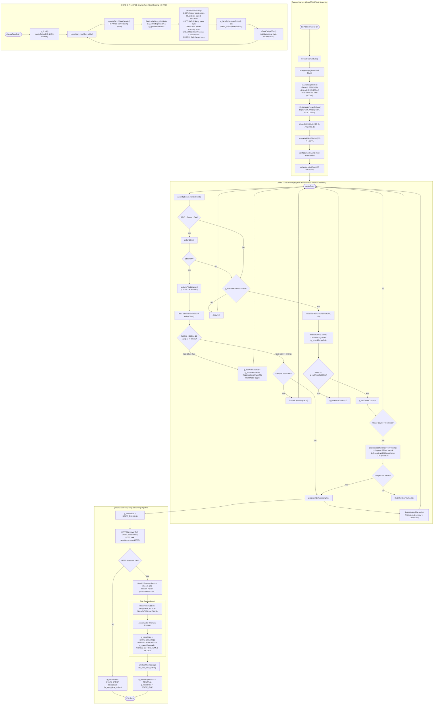

# 🔄 Production Robot Main (`robot_main`) — Master Dual-Core Flowchart & Function Architecture

## 📋 1. Overview
`robot_main/main.cpp` is the complete production firmware for the Tabletop Voice Assistant Robot. It implements a true **dual-core asymmetric multiprocessing** architecture on the ESP32-S3:
* **Core 0 (`DisplayTask`, FreeRTOS priority 1)**: Runs the non-blocking ~30 FPS LovyanGFX animated eye engine, rendering facial expressions (`BOOT`, `IDLE`, `LISTENING`, `THINKING`, `SPEAKING`, `ERROR`), amplitude-driven speech mouth bounce, and non-blocking servo arm wave gestures. Yields every frame (`vTaskDelay(33ms)`) so background Wi-Fi and LwIP network tasks run unimpeded.
* **Core 1 (Arduino `setup()` & `loop()`)**: Runs the real-time audio and cloud communications engine:
  1. Embedded LAN HTTP configuration server (`WebServer` on port 80).
  2. Dual-mode Push-to-Talk and Hands-Free Voice Activity Detection (VAD) with auto-calibrated noise floor and 250 ms circular PSRAM pre-roll buffer.
  3. Half-duplex acoustic echo protection (450 ms post-playback cooldown and DMA flush).
  4. Multi-backend dialogue pipeline: Gateway Mode (`/talk`) and Direct Mode (direct Gemini 3.1 / Chit API).
  5. Chunk-safe, pre-buffered I2S playback engine with odd-byte carryover guard.

---

## 🛠️ 2. Comprehensive Inventory of Enums, Classes & Functions

### State Machine Enums
* `enum RobotState : uint8_t`:
  * `STATE_BOOT (0)`: Booting up / connecting to Wi-Fi / syncing NTP clock (amber loading dots).
  * `STATE_IDLE (1)`: Awake, listening, blinking periodically, natural eye saccades (cyan eyes).
  * `STATE_LISTENING (2)`: Capturing user speech (pulsing wide green eyes).
  * `STATE_THINKING (3)`: Speech uploaded, awaiting LLM response (amber scanning eyes).
  * `STATE_SPEAKING (4)`: Synthesized audio playing through speaker (dynamic eye bounce and mouth animation).
  * `STATE_ERROR (5)`: Network or API failure (red slanted sad eyes).
* `enum RobotExpression : uint8_t`:
  * `EXPR_NEUTRAL (0)`: Default mouth bar.
  * `EXPR_WAVE (1)`: Crescent eyes + smiling mouth + physical servo arm waving.
  * `EXPR_HAPPY (2)`: Crescent smiling eyes + smiling mouth.
  * `EXPR_SURPRISED (3)`: Wide circular eyes + 'O' mouth.
  * `EXPR_SAD (4)`: Droopy eyes with angled outer brows.

---

### Core 0 Display & Expression Engine (Classes & Functions)
1. `class RobotDisplay : public lgfx::LGFX_Device`
   * Configures `SPI2_HOST` at 40 MHz, SPI Mode 3, `SCLK = GPIO 12`, `MOSI = GPIO 11`, `DC = GPIO 9`, `RST = GPIO 14`, and backlight PWM on `GPIO 13`.
2. `static void renderFaceFrame(RobotState state, uint32_t nowMs)`
   * Clears the 240x140 PSRAM face sprite (`g_faceSprite.fillScreen(TFT_BLACK)`).
   * Renders mathematical geometry for each state (blink cycles, look saccades, pulse animations, mouth bounce).
   * Pushes the updated 240x140 band to the display via SPI DMA (`pushSprite(0, 50)`).
3. `static void triggerServoWaveIfEnabled()`
   * Sets non-blocking timestamp `g_servoWaveStartMs = millis() | 1U`.
4. `static void updateServoWave(uint32_t nowMs)`
   * Non-blocking servo arm driver on `GPIO 18`. Sweeps between $45^\circ$ (1.0 ms) and $135^\circ$ (2.0 ms) twice, returns to $90^\circ$ neutral (1.5 ms), and detaches PWM pin.
5. `static void displayTask(void* param)`
   * Core 0 FreeRTOS worker. Initializes LovyanGFX, allocates 240x140 16-bit sprite in Octal PSRAM, and runs an infinite render loop with `vTaskDelay(pdMS_TO_TICKS(33))`.

---

### Core 1 Audio, DSP & Network Engine (Classes & Functions)
1. `class RobotVoiceI2SSink : public Stream`
   * **Custom Stream Sink**: Consumed by `HTTPClient::writeToStream()`.
   * `writeAlignedPcmToI2S(data, evenLen)`: Measures chunk RMS, updates volatile `g_speechBouncePx`, scales volume (`PLAYBACK_VOLUME = 0.35f`), duplicates mono into stereo `[L, L]`, and feeds `I2S_NUM_1`.
   * `write(buffer, size)`: Manages 1-byte odd carryover (`_hasCarry`) and accumulates 400 ms of audio in `_prebuf` before starting I2S DMA. Sets `g_robotState = STATE_SPEAKING`.
   * `flushRemaining()`: Plays residual pre-buffer audio, zeroes `g_speechBouncePx`, and flushes DMA descriptors.
2. `static void initAudioI2S()`
   * Installs and binds `I2S_NUM_0` (16 kHz RX Master) and `I2S_NUM_1` (24 kHz TX Master).
3. `static bool ensureWiFiAndClock()`
   * Verifies Wi-Fi connection and valid NTP time ($> 1,700,000,000$). Auto-reconnects and syncs if dropped.
4. `static int32_t readAndFilterMicChunk(int16_t* outSamples, size_t maxSamples, size_t& outCount)`
   * Reads 32-bit words from `I2S_NUM_0`, arithmetic right-shifts 11 bits, executes 1st-order IIR DC-blocker filter, clamps to `int16_t`, and returns chunk RMS.
5. `static void flushMicAfterPlayback()`
   * **Half-Duplex Echo Suppression**: Delays 450 ms post-playback for room reverberation decay, zeroes DMA buffer, clears DC filter state, and flushes 4 dummy frames.
6. `static void calibrateNoiseFloor()`
   * Samples 480 ms of ambient room sound. Sets `g_vadThresholdRms = max(750, ambientRms * 3)`. If mic is floating or ambient is invalid ($> 6000$), disables auto-VAD to prevent runaway loops.
7. `static size_t capturePttUtterance()`
   * Sets `g_robotState = STATE_LISTENING`, reads microphone chunks while `GPIO 1` is held down, and stores up to 8 seconds in `g_recordPsramBuf`.
8. `static size_t captureVadUtteranceFromPreroll()`
   * Prepends the 250 ms circular pre-roll buffer (preserving leading consonants), then records until 900 ms of trailing silence (`VAD_SILENCE_HANGOVER_MS`) or 8-second limit.
9. `static void processGatewayTurn(size_t sampleCount)`
   * Sends 16 kHz PCM to Gateway `/talk` over verified TLS.
   * Parses `X-Sample-Rate` and sets I2S playback clock.
   * Parses `X-Action` (`WAVE`, `HAPPY`, `SURPRISED`, `SAD`) and triggers expressions and servo gestures.
   * Streams audio chunks through `RobotVoiceI2SSink` into speaker.
   * Enforces zero automatic retries on error to prevent quota burn.
10. `static void processTalkTurn(size_t sampleCount)`
    * Dispatches to `processDirectTurn()` (Direct Mode) or `processGatewayTurn()` (Gateway Mode) based on `g_cfg.mode`.
11. `void setup()`
    * Initializes USB CDC Serial, configures `GPIO 1` pullup, loads NVS config (`configLoad()`), allocates 3 PSRAM buffers, spawns Core 0 `DisplayTask`, initializes audio hardware, connects to Wi-Fi/NTP, starts LAN config server (`configServerBegin()`), and calibrates noise floor.
12. `void loop()`
    * Polls `g_configServer.handleClient()`.
    * Checks `GPIO 1` button:
      * **Long Press ($\ge 400\text{ ms}$)**: Push-to-Talk manual recording.
      * **Short Tap ($< 350\text{ ms}$)**: Toggles Hands-Free Always-Listening VAD ON/OFF.
    * In VAD Mode: Continuously writes to circular pre-roll ring buffer. Triggers speech recording when RMS exceeds threshold for 3 consecutive frames (48 ms).

---

## 📊 3. Dual-Core Asymmetric Architecture Flowchart

